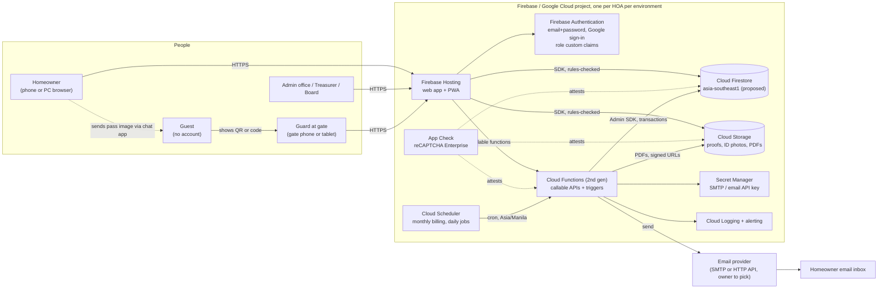
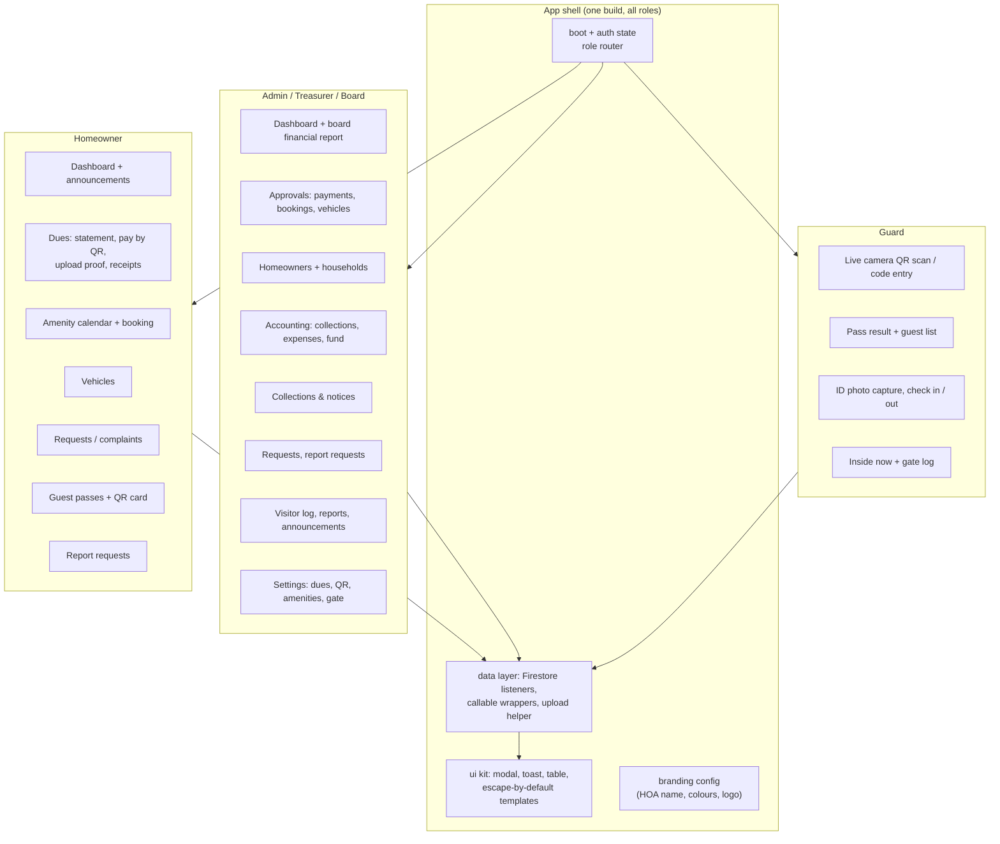
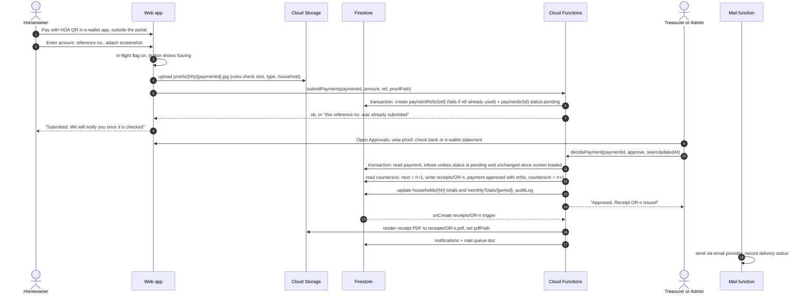
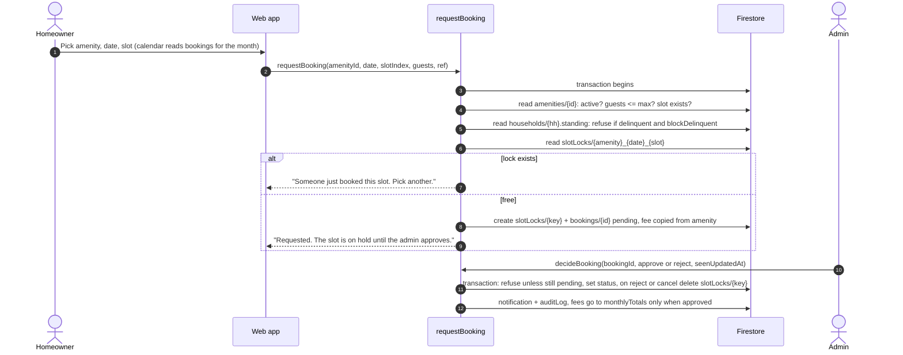
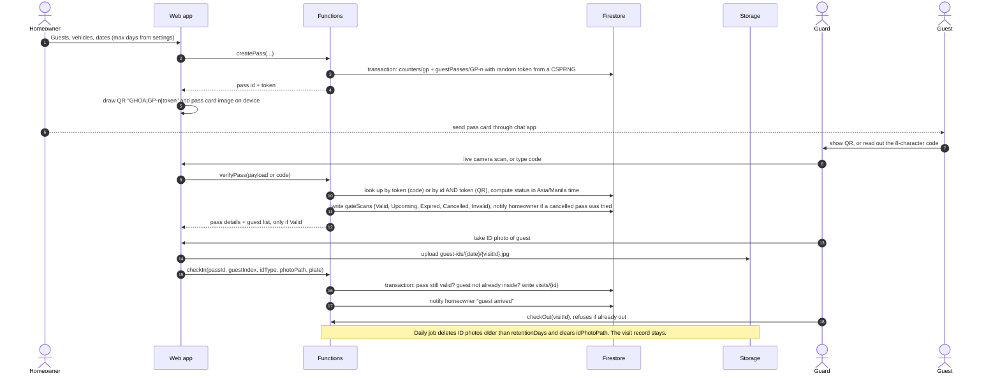
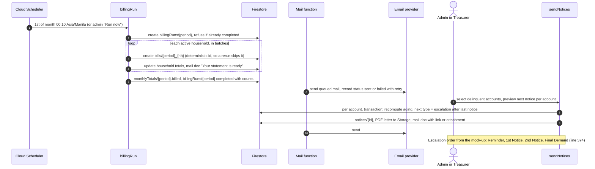

# SA-001 — HOA portal: solution architecture on Firebase

| | |
|---|---|
| **Raised by** | Owner: "Sol arch - can you review the app now. I want to start building it. I need you to review and write tech solutioning and architecture diagram. The plan is to use Firebase for app hosting and Authentication, Firestore for DB. If emails are needed, let's use Firebase as well." |
| **Baseline read** | `HOA_APP` branch `main`, commit `c079503`. No app version: there is no application code yet. |
| **What exists** | An interactive single-file mock-up with all data in browser storage and no backend: `index.html` (generic "Greenfield Homes HOA", 1,502 lines) and `gentri-heights/index.html` (Gentri Heights branding, 1,508 lines). `README.md` lists the features. `docs/backend-plan.md` is the existing backend plan with estimates. |
| **Greenfield?** | **Yes, for everything except the user experience.** The mock-up is the agreed scope and screen design. Its JavaScript is a prototype, not a specification: section 4.4 lists the behaviours that must change. |
| **Inputs received** | 1. Business context: README + backend plan. 2. Functional scope: the mock-up. 3. NFRs: scale (623+ households) and running cost ($0–15/month), both from `backend-plan.md`. Privacy and backups are named as work in area I. **Availability, performance, recovery targets and browser/device support: `NOT PROVIDED`.** 4. Integrations: none named beyond email. **Bank or e-wallet integration: `NOT PROVIDED`** (assumed none). 5. Constraints: Firebase Hosting, Firebase Authentication and Firestore, with email "using Firebase" (owner). **Budget, timeline and team: `NOT PROVIDED`** beyond the backend-plan estimates. 6. Stakeholders: the owner approves this document. **Client approvers (Gentri Heights board) and the client's Data Protection Officer: `NOT PROVIDED`.** |
| **Status** | **Draft.** This becomes final only when the owner writes exactly `APPROVED — FINAL`. |
| **Author / date** | Sol Arch, 2026-11-27 |
| **Revision** | r1, 2026-11-27: first draft. r2, 2026-11-28: follow-ups from the Sol Arch reviews of REQ-001 to REQ-004 (branch `docs/req-001-004`, commit `9b9ecd3`). Changed: staff removal check (§8.1, ADR-004), function list (§3), new collections and fields (§4.2), lot key, invite expiry and code handling, Auth go-live checklist (§8.4), email "failed" meaning (ADR-002), sale-privacy risk R-16, phase 1 estimate (§12). Items that depend on owner decisions due 2026-11-29 are marked **(provisional)** |

Related records, all Draft: [ADR-001](adr/ADR-001-firebase-platform.md) (Firebase platform and region), [ADR-002](adr/ADR-002-email-delivery.md) (email delivery), [ADR-003](adr/ADR-003-frontend-stack.md) (frontend stack), [ADR-004](adr/ADR-004-roles-and-household-linking.md) (roles and household linking), [ADR-005](adr/ADR-005-projects-and-environments.md) (projects and environments). Standards: [CODING-STANDARDS.md](CODING-STANDARDS.md). Lessons: [LEARNINGS.md](LEARNINGS.md) (L-001 to L-005).

---

## 1. Executive summary

We will build the real HOA portal on Google's Firebase, as you asked. Firebase Hosting serves the website, Firebase Authentication handles sign-in, Firestore stores the data, and Cloud Storage holds images such as payment screenshots and guest ID photos. One part of your plan needs to be adjusted: **Firebase cannot send email by itself.** It sends only its own sign-in emails, such as password resets. Statements, receipts and demand letters need a small piece of server code (a "Cloud Function") plus an outside email service, at a small monthly cost or free at our volume. Anything involving money or official records runs as server code, never in the homeowner's browser: approving payments, issuing official receipt numbers with no gaps, monthly billing, booking a slot, and checking a guest pass at the gate. That way a modified browser or two admins clicking at once cannot corrupt the books. The screens can be reused almost as they are. The mock-up's data handling must be rebuilt, and the client should answer the open questions in section 11.3 (questions 1–4 and 12 are about money) before the billing and payment features are built.

---

## 2. Architecture overview

**In plain words.** There are four kinds of people: homeowners, the admin office (with treasurer and board), guards at the gate, and guests, who never sign in. Everyone except guests uses the same website on a phone or computer. The website reads and writes Firestore directly for everyday things, such as filing a complaint or reading announcements. Firestore **security rules** decide who may see or change each record. Anything that must be exactly right or must happen on a schedule goes through **Cloud Functions**, which is server code we write and Google runs. That covers approving a payment and issuing receipt number OR-00123, generating 623 bills on the 1st of the month, reserving a pool slot, validating a guest pass, and sending email. Images go to **Cloud Storage**, and Firestore keeps only their file paths. Email leaves through an outside email provider. Google Cloud Scheduler triggers the monthly and daily jobs.

### 2a. System context



What sends the email: a Cloud Function we own reads a `mail` queue in Firestore and hands each message to the email provider over SMTP or the provider's API. Firebase's "Trigger Email from Firestore" extension does the same job, but the **Firebase Extensions service is deprecated and will shut down on 31 March 2027**. After that date installed extensions can no longer be updated or uninstalled. Sources: the extension page at extensions.dev/extensions/firebase/firestore-send-email, and firebase.google.com/docs/extensions/faq-and-troubleshooting, both fetched 2026-11-27. The extension also requires your own SMTP provider. So we write the roughly 100-line function ourselves and keep the same queue design. See [ADR-002](adr/ADR-002-email-delivery.md).

### 2b. App components by role



The router loads only the screens for the signed-in role. Hiding a screen is a convenience, not security: the rules and functions enforce every permission on the server (section 7).

---

## 3. Component breakdown

| Component | Responsibility | Technology | Lives in repo (proposed) |
|---|---|---|---|
| Web app | All screens for the three roles, built from the mock-up's markup and CSS | Vite build, plain JavaScript ES modules, `lit-html` templates (escapes by default), installable as a PWA. See [ADR-003](adr/ADR-003-frontend-stack.md) | `web/src/` (`app/`, `features/<area>/`, `ui/`, `data/`), `web/public/` |
| Pure domain logic | Ledger allocation, aging, notice escalation, pass validity, slot keys, money formatting. Shared by the web app and functions, and unit-tested without a browser | Plain JS modules | `shared/domain/` |
| Security rules | Who may read and write each Firestore document and Storage file. Field validation for client-side writes | `firestore.rules`, `storage.rules` | repo root |
| Cloud Functions | Everything that must be atomic, scheduled, secret or official (table below) | Node.js LTS, 2nd-gen Functions, Admin SDK | `functions/src/<area>/` |
| Scheduler jobs | Monthly billing, reminders, ID-photo deletion, mail retry, month-end totals | `onSchedule` functions, time zone `Asia/Manila` | `functions/src/jobs/` |
| Storage | Payment proofs, vehicle OR/CR (Official Receipt / Certificate of Registration), ticket photos, expense receipts, guest ID photos, generated PDFs, payment QR image | Cloud Storage for Firebase | paths in section 4.2 |
| Email | Queue and send transactional email | Own function + provider via Secret Manager | `functions/src/mail/` |
| Tests | Unit (Vitest, coverage in lcov format for SonarQube), rules tests and function integration tests on the Emulator Suite, end-to-end (Playwright) | | `**/*.test.js`, `tests/rules/`, `tests/e2e/` |

**What must be a Cloud Function, and what rules can handle.** This answers "where the stack fits" (section 6 has the full gap list).

| Operation | Where | Why |
|---|---|---|
| File request or complaint, add a ticket reply, register a vehicle, submit a payment (pending), create a report request | Client write, checked by rules | One document owned by the writer. Rules can check the owner, the fields and the starting status |
| Upload proof, photo or document | Client to Storage, checked by rules (size, type, path) | Rules check `request.auth`, size and content type |
| Approve or reject a payment, assign the OR (official receipt) number, make the receipt PDF, void a receipt | **Function** (callable `decidePayment`, `voidReceipt`) | Gap-free counter and status change in one transaction. Updates balance totals. Official PDF |
| Monthly billing | **Function** (scheduled plus an admin "run now" callable) | 623+ writes, idempotent, must not run twice |
| Request or cancel an amenity booking, approve a booking | **Function** (`requestBooking`, `decideBooking`) | Conflict-safe slot lock. Delinquency check reads server-kept totals |
| Approve a vehicle, assign a sticker number | **Function** | Sequential sticker counter |
| Ticket numbers `T-nnn`, `RR-nnn`, `GP-nnnn` | **Function**, or a random id with the number assigned by a trigger | Sequential counters need transactions |
| Create or cancel a guest pass | **Function** (`createPass`) | Server-generated secret token, validity limits |
| Validate a pass at the gate, check in or out, view an ID photo | **Function** (`verifyPass`, `checkIn`, `checkOut`, `getIdPhotoUrl`) | Tamper-proof scan log. Guards never list or search passes directly. Every ID-photo view is audited |
| Send notices or demand letters, statements, receipts by email | **Function** | Letter PDF, mail queue, provider secret |
| Notifications to many people (announcements) | Client write of one announcement doc, checked by rules. **No fan-out** | See section 4.4, item 8 |
| Expenses, settings, amenity prices | Client write, admin-only by rules. A trigger keeps monthly totals | Simple admin CRUD (create, read, update, delete) |
| Audit log | **Function / trigger only** | Clients cannot write their own audit trail |
| Role assignment | **Function** (`setRole`), called from a developer script in R1 and from a Staff page later | Custom claims can only be set with the Admin SDK. Also writes `staff/{uid}`. Revokes refresh tokens only on a removal or downgrade, never on a grant. Refuses to remove the last treasurer (counted inside a transaction over `staff`) |
| Invites and household linking | **Function** (`createInvites`, `checkInvite`, `redeemInvite`, `removeMember`, `cancelInvite`) | Codes are hashed, single-use and rate-limited. Redeeming creates the `members` doc in a transaction. Keeps `households.linkStatus` and `memberCount` |
| Household directory and import | **Function** (`previewHouseholdImport`, `commitHouseholdImport`, `createHousehold`, `updateHousehold` with `seenUpdatedAt`, `setHouseholdActive`) | Clients never write households: totals, lot-key uniqueness and audit are server-only |

---

## 4. Data model and data flow

### 4.1 Where the model comes from

Every entity below was taken from the mock-up's `seed()` function (`index.html` lines 465–534), `seedGate()` (lines 1097–1115), `seedRR()` (line 1236) and the write handlers in `ACT` (line 1333) and `FORMS` (line 1416). The branded copy (`gentri-heights/index.html`) differs only in branding. The check: `diff` with the HOA name normalised shows about 20 changed blocks, all in CSS, logos, title, the HOA name, the storage key (`gentri-heights-mock-v1`, line 379) and PDF colours, and none in data shapes. **So there is one data model and one codebase, with branding in configuration.**

| Mock-up collection (`S.*`) | Defined at | Real collection |
|---|---|---|
| `homeowners` `{id:'H01',name,lot,contact}` | line 468 | `households` + `users` + `members` (split, see 4.4 item 5) |
| `bills` `{id:'B'+period+hoId,hoId,period,amount}` | line 469, `genBilling` line 1387 | `bills/{period}_{householdId}` |
| `payments` `{id,hoId,amount,ref,date,status,proof,orNo,decided,reason}` | lines 472–474, `approvePay` 1369, `FORMS.pay` 1444 | `payments`, `receipts`, `paymentRefs` |
| `expenses` `{id,date,category,vendor,desc,amount,receipt}` | line 476, `FORMS.expense` 1466 | `expenses` |
| `amenities` `{id,name,fee,deposit,max,active,slots[],note}` | lines 482–486 | `amenities` |
| `bookings` `{id,hoId,amenityId,date,slot,status,guests,purpose,fee,deposit,ref,requested,approvedOn,reason}` | line 487, `FORMS.book` 1446 | `bookings` + `slotLocks` |
| `vehicles` `{id,hoId,plate,make,color,type,status,sticker,date,doc}` | lines 500–506, `approveVeh` 1373 | `vehicles` |
| `tickets` `{id:'T-101',hoId,category,subject,details,status,assignee,created,photo,updates[]}` | lines 507–512 | `tickets` + `tickets/{id}/updates` |
| `notices` `{id,hoId,type,date,balance,months}` | lines 513–518, `sendNotice` 1412 | `notices` |
| `announcements` `{id,date,title,body,important,seenBy[]}` | lines 519–522, `ackNews` 1365 | `announcements` + `announcements/{id}/reads/{uid}` |
| `notifs` `{id,to,text,date,read}` (`to` is a homeowner id, `'admin'` or `'guard'`) | `notify()` line 409 | `notifications` |
| `log` `{date,text}` | `log()` line 410 | `auditLog` (structured, function-written) |
| `settings` `{hoaName,monthlyDues,blockDelinquent,payee,acct,instructions,qr,openingFund,address,guard:{requireId,retentionDays,maxDays}}` | line 527, guard defaults line 1090 | `config/settings`, `config/branding` |
| `seq` `{or,sticker,ticket,rr,gp}` | line 528 | `counters/{name}` |
| `passes` `{id:'GP-1041',token,hoId,created,from,until,purpose,guests[{name}],vehicles[{plate,desc}],notes,status}` | `seedGate` line 1098, `FORMS.pass` 1417 | `guestPasses` |
| `visits` `{id,passId,hoId,guest,idType,idPhoto,plate,date,inTime,outTime,guard}` | lines 1104–1108, `FORMS.checkIn` 1429 | `visits` |
| `scans` `{id,date,time,method,passId,hoId,result,detail}` | lines 1109–1113, `recordScan` 1135 | `gateScans` |
| `reportReqs` `{id:'RR-101',hoId,type,period,purpose,format,notes,status,created,updated,file,history[]}` | line 1236, `FORMS.rr` 1435 | `reportRequests` |

### 4.2 Firestore data model

```mermaid
erDiagram
  HOUSEHOLDS ||--o{ MEMBERS : "has"
  USERS ||--o{ MEMBERS : "belongs via"
  USERS ||--o| STAFF : "may hold role"
  HOUSEHOLDS ||--o{ INVITES : "invited by"
  INVITES ||--o| MEMBERS : "redeemed into"
  HOUSEHOLDS ||--|| HOUSEHOLD_CONTACTS : "contacts"
  HOUSEHOLDS ||--o{ BILLS : "billed"
  HOUSEHOLDS ||--o{ PAYMENTS : "submits"
  PAYMENTS ||--o| RECEIPTS : "approved into"
  PAYMENTS ||--|| PAYMENT_REFS : "reserves ref"
  HOUSEHOLDS ||--o{ NOTICES : "receives"
  AMENITIES ||--o{ BOOKINGS : "booked as"
  BOOKINGS ||--|| SLOT_LOCKS : "holds"
  HOUSEHOLDS ||--o{ BOOKINGS : "requests"
  HOUSEHOLDS ||--o{ VEHICLES : "registers"
  HOUSEHOLDS ||--o{ TICKETS : "files"
  TICKETS ||--o{ TICKET_UPDATES : "has"
  HOUSEHOLDS ||--o{ REPORT_REQUESTS : "files"
  HOUSEHOLDS ||--o{ GUEST_PASSES : "creates"
  GUEST_PASSES ||--o{ VISITS : "used for"
  GUEST_PASSES ||--o{ GATE_SCANS : "scanned as"
  ANNOUNCEMENTS ||--o{ ANNOUNCEMENT_READS : "read by"
  MONTHLY_TOTALS }o--|| CONFIG : "uses settings"

  HOUSEHOLDS {
    string id PK "auto id"
    string lotKey UK "B04-L12 or P1-B04-L12, unique via lots/{lotKey}"
    string lotLabel "Blk 4 Lot 12"
    int block
    string lot "allows suffix, e.g. 12-A"
    string phase "or null"
    string displayName
    array searchTokens "lower-case name words"
    string linkStatus "kept by invite functions"
    int memberCount "kept by invite functions"
    int billedCentavos "kept by functions"
    int paidCentavos "kept by functions"
    int balanceCentavos "kept by functions"
    int overdueCount "kept by functions"
    string standing "good / delinquent"
    bool active
  }
  USERS {
    string uid PK "Auth uid"
    string name
    string email
    string phone
  }
  STAFF {
    string uid PK "Auth uid, written only by setRole"
    string role "admin / treasurer / board / guard"
    string displayName
    string grantedBy
    string requestRef "board's written request"
    timestamp grantedAt
  }
  MEMBERS {
    string id PK "householdId_uid"
    string householdId FK
    string uid FK
    string relation "owner / co-owner / tenant / family"
    string inviteId FK
    string invitedBy
    timestamp linkedAt
  }
  INVITES {
    string codeHash PK "keyed hash of the code"
    string householdId FK
    string channel "email / print"
    string sentTo "email or null"
    string relation
    timestamp expiresAt "expired is derived, not stored"
    string status "active / used / replaced / cancelled"
    string usedBy
    string mailId
  }
  HOUSEHOLD_CONTACTS {
    string householdId PK "staff-only"
    string contactEmail
    string contactMobile
  }
  BILLS {
    string id PK "period_householdId, deterministic"
    string householdId FK
    string period "YYYY-MM"
    int amountCentavos
    string dueDate "YYYY-MM-DD, Asia/Manila"
    string runId
  }
  PAYMENTS {
    string id PK "auto id"
    string householdId FK
    int amountCentavos
    string ref "e-wallet or bank reference no."
    string proofPath "Storage path"
    string status "pending / approved / rejected / voided"
    string orNo "set only by function"
    string decidedBy
    timestamp decidedAt
    string reason
  }
  RECEIPTS {
    string orNo PK "OR-00001, gap-free"
    string paymentId FK
    string householdId FK
    int amountCentavos
    string pdfPath
    bool voided
    string voidReason
  }
  PAYMENT_REFS {
    string ref PK "normalised reference no."
    string paymentId FK
  }
  AMENITIES {
    string id PK "pool / hall / pickle / bball"
    string name
    int feeCentavos
    int depositCentavos
    int maxGuests
    bool active
    array slots "08:00-10:00 ..."
  }
  BOOKINGS {
    string id PK "auto id"
    string householdId FK
    string amenityId FK
    string date
    string slot
    string status "pending / approved / rejected / cancelled"
    int guests
    int feeCentavos "copied at request time"
    string ref
  }
  SLOT_LOCKS {
    string id PK "amenityId_date_slotIndex"
    string bookingId FK
  }
  GUEST_PASSES {
    string id PK "GP-nnnn"
    string householdId FK
    string token "secret, 8+ chars, server-generated"
    string from
    string until
    array guests "name"
    array vehicles "plate, desc"
    string status "active / cancelled"
  }
  VISITS {
    string id PK
    string passId FK
    string householdId FK
    string guestName
    string idType
    string idPhotoPath "deleted after retention"
    timestamp inAt
    timestamp outAt
    string guardUid
  }
  GATE_SCANS {
    string id PK
    string passId
    string method "qr / code / list"
    string result "Valid / Upcoming / Expired / Cancelled / Invalid"
    string guardUid
    timestamp at
  }
  ANNOUNCEMENTS {
    string id PK
    string title
    string body
    bool important
    timestamp postedAt
  }
  ANNOUNCEMENT_READS {
    string uid PK
    timestamp ackAt
  }
  MONTHLY_TOTALS {
    string period PK "YYYY-MM"
    int billedCentavos
    int duesCentavos
    int feesCentavos
    int expensesCentavos
    bool closed
  }
  CONFIG {
    string id PK "settings / branding"
  }
```



Collections not drawn above, to keep the diagram readable: `vehicles`, `tickets` + `updates`, `notices`, `reportRequests`, `expenses`, `notifications`, `counters/{or|sticker|ticket|rr|gp}`, `billingRuns/{period}`, `auditLog`, `mail`, `lots/{lotKey}` (uniqueness index, functions only), `importRuns/{id}` (staff only; rejected rows hold personal data and are deleted by the daily job after 30 days, DPO to confirm), `inviteAttempts/{uid}` (functions only; 5 refused codes per 15 minutes per account; old windows deleted daily).

**Notes on the r2 additions:**

- **`householdContacts` is separate from `households`** because every member of a household reads `households/{id}`. After a sale the new owner would otherwise see the previous owner's email and mobile, and guards must not see contacts. Admin and treasurer read it; nobody else.
- **`staff/{uid}` replaces `users.staffRole`.** `users/{uid}` is written by the person themselves, so a role field there leaves one rules mistake between a homeowner and staff access. `staff` is written only by `setRole`. It is also what makes a removal take effect at once (§8.1).
- **`members.canPay` is dropped** until the payments REQ needs it (it had no writer or reader).
- **Lot key (provisional, ask the admin office before the import is built):** `B04-L12` assumes block numbers are unique across the subdivision. If phases reuse block numbers, the key is `P1-B04-L12`. Lot suffixes such as `12-A` are allowed. Re-keying after the import means rewriting every document, so this is settled first.
- **Invite codes:** the code exists in plain text only when it is created. It is shown or printed once, emailed once, and then removed from the `mail` document after hand-off to the provider. So reprinting always makes new codes and the old unused code stops working. The email link carries the code after `#`, so it never reaches server logs.
- **Indexes** (`firestore.indexes.json`): `households` (`active`, `block`, `lot`) for the default list and block search; `households` (`active`, `searchTokens` array-contains, `lotKey`) for name search; `invites` (`householdId`, `status`, `createdAt` desc). Search uses these indexed queries, 50 rows per page, never a scan of all households in the browser (623 reads per page open would exceed the free daily reads at normal office use).

**Storage paths** (all private, access by rule or signed URL):

| Path | Written by | Read by |
|---|---|---|
| `proofs/{householdId}/{paymentId}.jpg` | household member (rules: own household, image, ≤ 5 MB) | that household, admin, treasurer |
| `vehicles/{householdId}/{vehicleId}.jpg` | household member | that household, admin |
| `tickets/{ticketId}/{file}` | filer | filer's household, admin |
| `expenses/{expenseId}.jpg` | admin, treasurer | admin, treasurer, board |
| `guest-ids/{yyyy-mm-dd}/{visitId}.jpg` | guard (rules: guard claim, image, ≤ 2 MB) | **only through `getIdPhotoUrl`**, which logs each view (the mock-up already logs views, `viewId` line 1355). No direct read rule |
| `receipts/{orNo}.pdf`, `notices/{noticeId}.pdf`, `reports/{rrId}.{ext}` | functions only | owning household, admin |
| `config/payment-qr.png`, `config/logo.png` | admin | all signed-in users |

**Rules for every document:**

- **Money is stored in integer centavos.** The mock-up uses floating-point pesos (`amount:1800`, `fmt()` line 386).
- **Dates are `YYYY-MM-DD` strings in Asia/Manila time**, plus server timestamps for audit. The mock-up hard-codes `TODAY='2026-11-27'` (line 372).
- Every record that belongs to a household carries `householdId`, so admin screens can query across collections.

### 4.3 Key flows

#### Flow 1 — dues payment by QR, proof, approval, gap-free OR and PDF



Points that make this safe:

1. **The number and the approval happen in one transaction.** If anything fails, neither is saved. So the receipt sequence never has a gap or a duplicate. Firestore advises against sustained heavy writes to a single counter document, but approvals are human-paced, so one counter document is enough.
2. **A void never frees a number.** `voidReceipt` marks the receipt voided, with a reason and who voided it, then reverses the totals. Whether voids and receipts must follow the BIR (Bureau of Internal Revenue) official-receipt format is an open client decision. It may require pre-registered number ranges or BIR-accredited printing.
3. **The two guards** ([CODING-STANDARDS](CODING-STANDARDS.md) rule 5): the in-flight flag on the button, **and** the in-transaction refusal when the status is no longer `pending`. The mock-up's `approvePay` (line 1369) has neither: it never checks `p.status` first, so a second click or a second admin would issue a second OR number for the same payment.
4. **The PDF is made after the number is committed**, by a trigger that can retry safely: it rebuilds the same file. The homeowner sees "Receipt OR-n issued, PDF preparing" until `pdfPath` is set. The screen copy must not promise a downloadable file before it exists.
5. **The portal cannot confirm that money arrived.** There is no bank or e-wallet integration, so the treasurer still checks the account statement. The copy must say "submitted for checking", not "paid".

#### Flow 2 — amenity booking with conflict-safe slot reservation



The slot lock document's id **is** the slot, so two requests at the same moment cannot both win. One transaction creates it and the other finds it already there. The mock-up only greys out taken slots on screen (`slotPanel`, line 667). `FORMS.book` (line 1446) does not re-check, so two homeowners on two phones could both hold the same slot. Cancel, reject and admin delete must all delete the lock in the same transaction, because Firestore does not cascade deletes.

#### Flow 3 — guest pass creation, guard scan, entry and exit log



**Security finding in the mock-up:** `lookupPass` (line 1142) accepts a **pass id without its token**. Typing `GP1046` matches pass `GP-1046`, and pass ids are sequential (`S.seq.gp++`, line 1424). Anyone who guesses the next number would get a valid pass. In the real app a typed code must match the **secret token**, and a QR must match both the id **and** the token. The token comes from a CSPRNG (cryptographically secure random number generator), as the mock-up already does at line 1093: 8 characters from a 32-character alphabet. Rate-limit `verifyPass` per guard device. Guards do not get list or search access to `guestPasses`. The "expected today" list comes from a function that returns only today's passes, without tokens.

#### Flow 4 — monthly billing, reminders and demand letters by email



The mock-up's billing ids are already deterministic (`'B'+period+hoId`, lines 469 and 1387), which is what makes a rerun safe. Keep that. Whether reminders send automatically on a date or only when an admin clicks (as in the mock-up, `sendNotice` line 1412) is a client decision (8.2). Until it is decided the design supports both. Demand letters carry legal weight, so their wording and signatory are client decisions, and a sent letter is stored immutably.

### 4.4 Mock-up behaviours that must change in the real app

| # | Mock-up behaviour (line) | Real app |
|---|---|---|
| 1 | Balances are recomputed in the browser from every bill and payment on every screen (`ledger()` lines 414–425). The fund summary scans all records since the start (`fundFor()` line 433) | Functions keep `households/{id}` totals and `monthlyTotals/{period}`. The same oldest-bill-first allocation rule lives in `shared/domain/ledger.js` with unit tests. Reports read the totals, not the history |
| 2 | `approvePay` and `approveBook` change status without checking the current status (lines 1369, 1371) | Callable functions with an in-transaction status check (two guards) |
| 3 | Booking conflict check exists only on screen (line 667 vs 1446) | `slotLocks` transaction (Flow 2) |
| 4 | Pass lookup by id without token (line 1142) | Token required (Flow 3) |
| 5 | One `homeowners` record per lot holds name and contact (line 468). There are no user accounts | `households` (the lot), `users` (a person who signs in), `members` (who belongs to which household, with relation). This supports co-owners, tenants and multiple lots once the client decides |
| 6 | Images stored as base64 data URLs inside the data (`readImage` line 411, `proof`, `idPhoto`, `doc`) | Cloud Storage files. Firestore holds the path. A Firestore document is limited to 1 MiB, and images in documents make every read expensive |
| 7 | ID-photo deletion is a manual admin button (`purgeIds` line 1356) | Daily scheduled job using `retentionDays` from settings, with a Storage lifecycle rule as backstop at the maximum allowed retention |
| 8 | Each announcement writes one notification per homeowner (`FORMS.announce` line 1468). Pop-up acknowledgement appends to a `seenBy` array on the announcement (line 1365) | One announcement document. Each person's acknowledgement goes in `announcements/{id}/reads/{uid}`. At 623+ households, a growing array in one document risks the 1 MiB limit and write contention |
| 9 | Audit log is free text written by the browser (line 410) | `auditLog` written only by functions and triggers: actor uid, action, target, before/after status, time |
| 10 | Libraries loaded from public CDNs at fixed versions (lines 367–370) | Bundled from npm with exact versions (CODING-STANDARDS rule 7) |
| 11 | Every screen is a string inserted with `innerHTML` (main render, line 975; 5 lines use `innerHTML` in `index.html`, including the tooltip at line 1493). User text is safe only where each template remembers to call `esc()` (line 385). Not audited template by template | `lit-html` templates escape by default. Any `innerHTML` with user data is a review finding |
| 12 | Delete handlers for vehicles, expenses and announcements remove records outright (`removeVeh` 1379, `delExpense` 1407, `delNews` 1408) | Soft delete (status `withdrawn`/`deleted`) for anything a total, sticker or audit points at. Expense deletes adjust `monthlyTotals` in the same transaction, and closed months refuse edits |

---

## 5. Integration points

| System | Direction | Protocol / auth | Notes |
|---|---|---|---|
| Email provider (choose one with SMTP or HTTP API) | out | SMTP over TLS or HTTPS API. Key in Secret Manager | Needs the HOA's sending domain with SPF/DKIM/DMARC records (email authentication standards) so letters are not flagged as spam. Ask the client whether they own a domain (8.2) |
| Firebase Authentication emails (verification, password reset, sign-in link) | out | Built into Firebase | Free, limited templates. This is the only email "Firebase" sends by itself |
| E-wallets / banks (QR Ph) | **none** | — | Homeowners pay outside the portal. Automated reconciliation is out of scope (`NOT PROVIDED`) |
| SMS | none (recommended) | — | Phone sign-in is billed per SMS sent (firebase.google.com/pricing, fetched 2026-11-27, which points to Identity Platform pricing for rates). Not recommended. In-app notifications plus email instead |
| Guest's phone | none | — | Pass card is a PNG the homeowner shares by chat (as in the mock-up, `passCardPng` line 1122) |

---

## 6. Where the owner's stack fits, and the gaps

| You asked for | Fits? | What it really takes |
|---|---|---|
| Firebase Hosting | Yes | One Hosting site per HOA per environment |
| Firebase Authentication | Yes | Email+password and Google sign-in. Roles as custom claims set by a function ([ADR-004](adr/ADR-004-roles-and-household-linking.md)) |
| Firestore as the database | Yes | Plus **security rules** (the real access control) and **rules unit tests** |
| "Emails through Firebase" | **Partly** | Firebase sends only its own sign-in emails. Transactional email needs (a) a Cloud Function and (b) an **outside email provider**: SMTP or API, with a free tier or a small monthly fee. The ready-made "Trigger Email" extension still needs that provider and its platform shuts down on 31 March 2027 ([ADR-002](adr/ADR-002-email-delivery.md)) |
| (not mentioned) **Cloud Functions** | **Required** | Receipts, billing, bookings, gate checks, email and roles cannot be made safe with rules alone (section 3 table) |
| (not mentioned) **Cloud Storage** | **Required** | Payment screenshots, ID photos, OR/CR documents and PDFs. Never images in Firestore |
| (not mentioned) **Blaze (pay-as-you-go) plan** | **Required** | Cloud Functions, Cloud Storage buckets, scheduled jobs and PITR all need billing enabled (pricing page and PITR page, fetched 2026-11-27). Set a budget alert at a small amount on day one |
| (not mentioned) **Cloud Scheduler**, **Secret Manager**, **App Check** | Required | Small, part of the same project |

---

## 7. NFR mapping

Only NFRs actually received are listed. Others are `NOT PROVIDED` (see the Assumptions section, A-6 to A-9).

| NFR (source) | Design decision | How verified |
|---|---|---|
| **Scale: 623+ households** (`backend-plan.md`) | Per-household totals and monthly totals instead of scans over all history. Billing in batches. Lists paginated (50 per page). Indexed queries only | Seed the emulator with 700 households and 12 months of bills and payments. Time the billing run and dashboard loads. Count document reads per screen in an automated test |
| **Running cost ≈ $0–15/month** (`backend-plan.md`) | Read summary documents, not history. No SMS sign-in. Images compressed on device before upload (the mock-up already does: 1000 px, JPEG quality 0.72, line 411). ID photos deleted on schedule. Budget alert | Monthly billing report vs. budget. Read and write counts from the Firestore usage dashboard after one month of pilot. See estimate below |
| **Privacy (Data Privacy Act)** (`backend-plan.md` area I) | Section 8 controls | Rules tests prove each role sees only what it should. Retention job tested in the emulator. Client DPO review |
| **Backups** (`backend-plan.md` area I) | PITR (point-in-time recovery) on: 7-day window, one version per minute. Daily scheduled backup with retention up to 14 weeks (the maximum). Restore goes to a **new** database (firebase.google.com/docs/firestore/pitr and /backups, fetched 2026-11-27) | A restore drill in staging before go-live, documented with the time it took |

**Cost estimate (assumption, to be checked against current rates before quoting to the client).** Free daily allowances on the pricing page (fetched 2026-11-27): Firestore 50K reads, 20K writes and 20K deletes per day, 1 GiB stored. Cloud Functions 2M invocations per month. Cloud Storage 5 GB-months, but that free allowance applies **only to buckets in us-central1, us-west1 and us-east1**. Rough usage: 300 sessions a day × about 60 reads ≈ 18K reads a day. Billing ≈ 1.3K writes a month. Payment proofs about 150 KB × 700 a month ≈ 100 MB a month. ID photos about 100 KB × 50 visits a day × 30-day retention ≈ 150 MB at any time. All of that is within or near the free tier. Paid items: Storage if the bucket is in Asia, PITR and backup storage (no free tier), and the email provider. That is consistent with the backend plan's $0–15 a month. **Biggest cost risk at 10× scale:** an unbounded list, or a dashboard that reads history instead of totals.

---

## 8. Security and privacy

### 8.1 Roles and how they are enforced

| Role | Signs in with | Can | Must not | Enforced by |
|---|---|---|---|---|
| Homeowner (household member) | Email+password or Google. Invited by admin | See and act on own household only: dues, bookings, vehicles, tickets, passes, report requests. Read announcements | See other households, staff screens, guest ID photos | Rules: `isMember(householdId)` via `members/{hh}_{uid}` |
| Admin (office staff) | Email+password, verified email. 2-step verification with an authenticator app (TOTP) if the owner adopts it (§8.4) | Run operations: approvals (if the client allows), tickets, notices, announcements, settings | Change OR numbers. Edit closed months. Read raw ID photos without a logged view | Claim `role: admin`, functions for privileged writes |
| Treasurer | as Admin | Approve payments, void receipts, record expenses, close months | — | Claim `role: treasurer` |
| Board | as Admin | Read financial reports and approvals (read-only unless the client decides otherwise) | Write | Claim `role: board` |
| Guard | Individual account on a gate device (recommended), or a gate-post account (client decision) | Verify passes, check in and out, capture ID photo | Browse passes, households or finances. Read old ID photos except through the logged function | Claim `role: guard`. Gate actions are function-only |
| Guest | No account | — | — | The pass token is the only credential |

**Custom claims vs role documents** ([ADR-004](adr/ADR-004-roles-and-household-linking.md)): staff role in a **custom claim**. It is small, rarely changes, and rules can check it without a read. The claim payload limit is 1,000 bytes (firebase.google.com/docs/auth/admin/custom-claims, fetched 2026-11-27). **Household membership in `members` documents**, because one person can belong to several lots and a lot can have several people. A claim change takes effect only when the user's ID token refreshes, and **revoking refresh tokens does not stop Firestore rules accepting the ID token the person already holds**, which stays valid for up to an hour. So revocation alone does not make a removal bite at once. **Recommended (provisional, owner choosing "at once" vs "within 1 hour"):** staff rules check both the `role` claim **and** a server-written `staff/{uid}` document with the same role (`isStaff()` = claim matches and `get(staff/{uid}).role` matches). That costs about one extra document read per staff request, and a removed or downgraded person is refused on their next request. `setRole` deletes or updates `staff/{uid}` and revokes refresh tokens only on a removal or downgrade, never on a grant, and refuses to remove the last treasurer. Callable functions check the same document. If the owner picks "within 1 hour", rules check the claim only and the removal takes effect when the token expires. Homeowner removal is already immediate either way, because rules check that the `members` document exists.

**Household linking:** admin creates the household (lot) and an **invite** (single-use code, stored as a keyed hash, sent by email or printed). **Expiry is per channel, as settings (provisional): 7 days for email, 30 days for a printed slip, ending at the end of the day in Asia/Manila.** One active invite per household and recipient (an email, or "print"). `checkInvite` shows the lot and owner name on a confirm screen before `redeemInvite`, and both count towards the attempt limit. The homeowner signs up and enters the code, and `redeemInvite` creates the `members` doc in a transaction that refuses an expired or used invite. **Nobody gets household access by matching an email or phone number**: shared family emails and phones are common. A signed-in user with no membership and no role sees only an "ask the admin office for your invite code" screen, and rules deny everything else.

**Firestore rules approach:** deny by default. Helper functions `isStaff()`, `hasRole(r)`, `isMember(hh)`. Clients may create only documents whose `householdId` they belong to, only in the starting status (`pending`, `Open`, `Submitted`), with a closed list of allowed fields. They can never set `status` past the start, `orNo`, `sticker`, totals or audit fields. Every status-gated clause is tested against every prior status. The rules are tested with `@firebase/rules-unit-testing` on the emulator in CI. SonarQube cannot read rules, so these tests are the only check.

### 8.2 Privacy (Philippine Data Privacy Act of 2012, RA 10173)

This section maps the design to the Act. It is **not a compliance claim**. Each item says "maps to … — requester to confirm" with the client's Data Protection Officer (DPO).

| Personal data | Where | Control | Maps to (requester to confirm) |
|---|---|---|---|
| Homeowner name, lot, contact, email | `users`, `households` | Visible to own household and staff only. Not in URLs, logs or email subjects | Proportionality, security of personal information |
| Guest names and plates (given by the homeowner) | `guestPasses`, `visits` | Notice to the homeowner at pass creation that guest data is shared with the guard. Short retention for visit records (client to set) | Transparency, lawful basis for third-party data |
| **Guest ID photos** (government IDs: may include ID numbers, birth dates, addresses, which can be sensitive personal information) | Storage `guest-ids/` | Taken only if `requireId` is on (default on, line 1090). Never shown to the homeowner. Viewed only through the logged function. Deleted by a daily job after `retentionDays` (mock-up default 30). Storage lifecycle rule as backstop. Privacy notice posted at the gate | Retention limitation, data minimisation, access logging |
| Payment screenshots, OR/CR documents | Storage | Own household + staff. Retention per the client's financial records policy | Retention per records law, requester to confirm |
| Audit log | `auditLog` | No personal data in free text. Ids and action codes only | Accountability |

Also, all requester to confirm: name a DPO; set a breach-response procedure, including notification to the National Privacy Commission within the period its rules set; a privacy notice in the app; a process for a homeowner to request access to or correction of their data. **Region:** placing data in Singapore (`asia-southeast1`) is a cross-border transfer. The client's DPO should confirm that is acceptable.

### 8.3 Other controls

- **App Check** (reCAPTCHA Enterprise for web) on Firestore, Storage and Functions. Monitor first, then enforce after two weeks of clean metrics. It is free subject to provider quotas (pricing page).
- **Secrets:** email provider key in Secret Manager. Never in the repo, the client config or logs. The Firebase web config is public by design. Security comes from rules and App Check.
- **Backups and recovery:** PITR plus daily backup (section 7). Choose the Firestore location carefully, because **it cannot be changed after creation**. Wrong region means a new project.
- **Audit:** every approval, void, role change, ID-photo view, ID-photo deletion run and settings change goes into `auditLog`.
- **Observability:** structured logs from functions, without personal data. Alert policies on function error rate, a `billingRuns/{period}` not `completed` by 02:00, `mail` documents in `failed`, and the retention job not having run in 26 hours. A weekly admin "system health" card reads those. Every `setRole` call alerts the owner (rare, so each one is worth seeing).

### 8.4 Authentication settings (go-live checklist, every Firebase project)

These are project settings, not code, so they can drift between staging and production. They go on a per-project go-live checklist ([ADR-005](adr/ADR-005-projects-and-environments.md)), checked before each project takes real users.

| Setting | Value | Why |
|---|---|---|
| Email enumeration protection | On (default for projects created on or after 15 Sep 2023) | A wrong password and an unknown email return the same error |
| Password policy | Require, minimum 8 characters | Firebase's default minimum is 6. The browser check alone is advice. Whether the policy needs the Identity Platform upgrade: check in the console |
| Verification email | Sent at account creation (free) | Makes the "Google sign-in takes over an unverified password account" case rarer, and staff 2-step needs a verified email |
| Google sign-in | Popup flow, or our own `authDomain` | Redirect sign-in breaks in browsers that block third-party storage unless the app is served from `firebaseapp.com` |
| Firestore web cache | Memory-only in R1 (the default) | A persistent cache would leave household data on a shared phone after sign-out |
| Authorised domains | Only that project's own domains | A test domain must never be authorised on production |
| Staff 2-step verification (if adopted) | **Firebase Authentication with Identity Platform** upgrade; TOTP (authenticator app), not SMS; verified email required; Admin SDK 11.6.0+, Web SDK 9.19.1+ | MFA is available only after the upgrade. TOTP has no per-message charge. Pricing lists Identity Platform as no-cost up to 50K monthly active users on Blaze, but **whether MFA itself is charged is Uncertain** (the Identity Platform pricing page did not load on 2026-11-28). Check in the console, confirm whether the upgrade can be undone, and do it in staging first. Enforcement by `setRole` plus a token check, to be proven on the emulator. Size: +1–1.5 days |

---

## 9. Frontend: turning the mock-up into the real app

**Recommendation: no heavy framework.** Vite (build tool) + plain JavaScript ES modules + `lit-html` (a small templating library that escapes user text by default) + the Firebase web SDK from npm. The mock-up is already built the way this stack likes: string templates rendered by view functions, and actions routed through lookup tables (`ACT` line 1333, `FORMS` line 1416, `CHANGE` line 1473) rather than one giant switch. The `data-act` hooks (on 67 lines) map one-to-one onto small handler modules. React or Vue would mean rewriting every screen for little gain at this size (alternatives in [ADR-003](adr/ADR-003-frontend-stack.md)).

Module structure (each file small; each function ≤ 15 cognitive complexity, per the SonarQube gate):

```
web/src/
  main.js                 boot, auth listener, role router
  config/branding.js      HOA name, colours, logo (from config/branding doc)
  data/                   firestore.js, functions.js (callable wrappers), storage.js (compress + upload)
  ui/                     modal.js, toast.js, table.js, calendar.js, qr.js, camera-scan.js
  features/
    dues/ amenities/ vehicles/ tickets/ passes/ reports/ announcements/   (homeowner)
    approvals/ households/ accounting/ collections/ visitors/ settings/   (admin)
    gate/                                                                (guard)
shared/domain/            ledger.js, aging.js, notices.js, passStatus.js, slots.js, money.js, dates.js
functions/src/            payments/ billing/ bookings/ gate/ notices/ mail/ roles/ jobs/ triggers/
```

- **Reuse:** the mock-up's CSS (design tokens in `:root`), markup and copy move over with little change. The data layer and every handler are rewritten against Firestore and functions.
- **One codebase, many HOAs:** the two mock-ups differ only in branding (section 4.1). Branding is configuration, never a fork.
- **Guard device:** live camera scanning via the browser's `BarcodeDetector` where supported, with a JavaScript QR decoder fallback (the mock-up uses jsQR 1.4.0, line 370). Installable PWA (progressive web app) with a large-button layout. It needs a network connection to validate passes. Offline gate mode is **out of scope** unless the client asks (risk R-10).
- **PDFs:** official documents (receipts, notices, certificates, certified statements) are made by functions and stored, so the same file is always reproduced. Exports that are not official (CSV) stay in the browser.

---

## 10. Environments, CI/CD and testing

| Environment | Firebase project (proposed name; role in the name) | Who uses it | Deploys |
|---|---|---|---|
| Local | Emulator Suite (no cloud project) | Developers, all automated tests | — |
| Staging / test | `hoa-portal-staging` | QA, owner demos, client UAT (user acceptance testing) with fake data | Auto on merge to `main` |
| Production, one per client | `hoa-<client>-prod`, e.g. `hoa-gentri-prod` | Real homeowners | Manual, owner approval per deploy |

Project names state their role, so nobody mistakes the live site for the test site ([ADR-005](adr/ADR-005-projects-and-environments.md)). Test data never goes to prod. Prod data never comes down to staging, except a de-identified copy if ever needed. Email in staging goes only to an allow-list of test addresses (a check in the mail function), so a test run cannot email real homeowners.

**CI (GitHub Actions)** on every pull request: lint and format check, unit tests with coverage, rules tests and function integration tests on the emulator, build. **Merge to `main`** deploys staging in this order: functions and rules (backward-compatible first), then hosting. **Production** is a manual workflow with an approval step. It runs the same order and records the commit, the rules version and the function revisions.

**Testing levels:** unit (domain logic, ≥ 80% coverage on new code); rules (every collection × every role × allowed and denied); function integration on the emulator, including **concurrency tests** (N parallel `decidePayment` calls produce one receipt; N parallel `requestBooking` calls produce one lock); end-to-end (Playwright) for the main journey of each role against the emulator or staging.

**SonarQube gate:** per [CODING-STANDARDS](CODING-STANDARDS.md). Self-hosted SonarQube Community Build at `http://localhost:9000`, project key `hoa-portal`, run by Dev before every merge to `main`. The mock-up HTML files are excluded from analysis. The free edition does not trace XSS, so "0 vulnerabilities" is not a security sign-off. The escaping rules and code review cover XSS.

---

## 11. Risks and open questions

### 11.1 Ranked risks

| # | Risk | Likelihood | Impact | Mitigation | Who decides |
|---|---|---|---|---|---|
| R-1 | **Official receipts do not meet BIR rules** (format, numbering, voids), so the client cannot use them | Medium | High | Get the client's answer before building area C. Keep numbering in one function with a configurable prefix and start number | Client (treasurer/accountant) |
| R-2 | **Duplicate or skipped receipt numbers, or double approvals**, copied from the mock-up's unchecked `approvePay` | High if copied | High | `decidePayment` transaction + concurrency test (Flow 1) | Sol Arch / Dev |
| R-3 | **Forged guest passes** via sequential ids (mock-up line 1142) | High if copied | High (security of the subdivision) | Token required, rate limit, guards cannot list passes (Flow 3) | Sol Arch / Dev |
| R-4 | **ID photos kept too long or seen by the wrong people** (Data Privacy Act exposure) | Medium | High | Function-only viewing with audit, daily deletion job + lifecycle backstop, DPO sign-off | Client DPO |
| R-5 | **Email not delivered** (spam folder, no provider, extension shutdown) while the UI says "sent" | Medium | Medium–High (demand letters) | Own mail function, domain authentication, delivery status shown to admin as "queued / sent / failed", never "delivered" | Owner (provider), client (domain) |
| R-6 | **Wrong household linking**: shared emails or phones, multiple lots, tenants | Medium | High (one family sees another's finances) | Invite codes only. `members` model. Client decides tenant and multiple-lot rules first | Client |
| R-7 | **Double-booked amenity slots** | High if copied | Medium | `slotLocks` (Flow 2) | Dev |
| R-8 | **Onboarding 623+ households** is not in the estimates (`backend-plan.md` excludes migration and onboarding) | High | Medium (schedule) | Bulk import of households and opening balances from a spreadsheet (a function, tested), printed invite codes, an admin help-desk week | Owner |
| R-9 | **Wrong Firestore or Storage region** chosen and fixed for good. Cost vs locality trade-off on Storage free tier | Low | Medium | Decide in phase 0, record in ADR-001 | Owner + client DPO |
| R-10 | **Gate stops when the network drops** (guard device offline) | Medium | Medium | Paper fallback log + "call the homeowner" procedure. Offline mode only if the client requires it (a project, not a tweak) | Client |
| R-11 | **Balances and reports drift** when totals are updated by several code paths | Medium | High | All totals written only by functions, one shared ledger module, nightly reconciliation job comparing totals with a recount, month close locks a period | Dev / treasurer |
| R-12 | **Copy promises outcomes the system cannot deliver** ("paid", "the homeowner was notified", "sent") | High | Medium | Copy review against behaviour in every requirement (CODING-STANDARDS rule 12) | BA + Sol Arch |
| R-13 | **Cost surprise** from unbounded reads or SMS | Low | Medium | Budget alert, no SMS sign-in, read-count tests | Owner |
| R-14 | **Vendor lock-in** to Firestore | Certain | Low | Accepted by the owner's stack choice. Scheduled backups and exports give a way out. Domain logic in plain modules | Owner |
| R-15 | **Time-zone errors** in due dates, pass validity, schedules | Medium | Medium | All business dates computed in `Asia/Manila` in `shared/domain/dates.js` with tests around midnight and month-end | Dev |
| R-16 | **Previous owner's records visible after a sale** (RA 10173). Bills and payments stay with the lot, so a new owner, once linked, would see the previous owner's receipts (with their name) and uploaded payment screenshots (which can show their e-wallet name and number) | High once a lot is sold | High (privacy) | Options: members see records from their `linkedAt` date only, or proofs are visible only to the uploader and staff. Contacts are already split into `householdContacts`. **Must be decided before the payments REQ (EPIC-003).** Maps to proportionality; requester and DPO to confirm | Owner + client DPO |
| R-17 | **A removed staff member keeps access for up to an hour** if rules check the role claim only (revoking tokens does not stop the current ID token) | Medium | High (finance access) | `staff/{uid}` double check in rules (§8.1), stale-token rules tests | Owner (at once vs 1 hour) |

### 11.2 Risk checklist (each item answered)

| Item | Answer |
|---|---|
| Repeat-trigger safety | Applies to payment submit, approvals, voids, booking, pass creation, check-in, notices, billing, announcements, invites. All have two guards: in-flight flag + transaction refusal or deterministic id. Billing uses `billingRuns/{period}` + deterministic bill ids |
| Stale references | Booking copies the fee at request time. Approval refuses when the status changed since load (`seenUpdatedAt`). Check-in re-reads pass validity in the transaction. Payment approval re-reads the household |
| Deletes don't cascade | Booking cancel and reject delete `slotLocks`. Household deactivation (not delete) keeps bills and receipts. Vehicles, expenses, announcements soft-deleted (section 4.4, item 12). Deleting a pass is a cancel |
| Field written and never read | Round-trip register owed per feature by QA. Totals are written by functions and read by dashboards. `idPhotoPath` cleared by the retention job and read by the visitor log, which must show "photo deleted" |
| Schema/rules and code paired | Rules + functions deploy before hosting. Rules tests in CI |
| Shared helper changed for one caller | `shared/domain` is used by web and functions. Any change runs both suites |
| Copy promising outcomes | R-12. Flow 1 point 5 |
| Existing data | Greenfield, but there is an opening-balance import (R-8). Mock-up browser data is never migrated |
| Identity keys | Lot key unique via `lots/{lotKey}`. People via Auth uid, never email or phone. Payment reference unique via `paymentRefs` |
| Roles and leakage | Section 8.1. Guards have no finance access. Board is read-only. Enforced in rules and functions |
| Multiple environments | Separate projects. Staging mail allow-list. Role in each project name |
| Secrets and PII | Secret Manager. No personal data in logs, URLs or audit text. ID photos function-only. Test fixtures use invented names |
| Offline / flaky network | Uploads resumable with retry. Callables are idempotent by id. Gate offline: R-10 |
| Scale and cost | Section 7 |
| Vendor lock-in / dependencies | R-14. npm exact pins. No CDN at runtime |
| Observability | Section 8.3 alerts |

### 11.3 Open questions for the owner and client

From `backend-plan.md` (still open):

1. **Late penalty or interest rules.** Rate, grace period, simple or compound, and from which date.
2. **Owners with several lots, and tenant accounts.** Can a tenant see dues? Pay? Book amenities? Create guest passes?
3. **Who approves what.** Treasurer only, or treasurer plus board, for payments, voids, bookings and vehicles?
4. **BIR-format official receipts?** If yes, what numbering and printing rules apply (R-1)?
5. **Board financial report:** entered by hand, or calculated from transactions?

Added by this review:

6. **One HOA or many?** Is this built for Gentri Heights only, or as a product for several HOAs? The recommendation is one Firebase project per HOA ([ADR-005](adr/ADR-005-projects-and-environments.md)) either way. Confirm.
7. **Email provider and sending domain.** Does the HOA own a domain (e.g. for `noreply@…`)? Which provider? Owner to pick on cost.
8. **Guard accounts:** one per guard, or one per gate post? The security agency's staff turnover matters here.
9. **Reminders:** automatic on a schedule, or admin-triggered (as in the mock-up)?
10. **Retention periods:** ID photos (mock-up default 30 days), visit and scan logs, payment proofs.
11. **Region:** Firestore in `asia-southeast1` (Singapore) is proposed. Is data outside the Philippines acceptable to the client?
12. **Advance and over-payments:** carried as credit (the mock-up's allocation leaves an over-payment as a negative balance), or refused?

---

## 12. Phased build roadmap (aligned to `backend-plan.md` areas A–K)

| Phase | Delivers | Areas | Estimate with Claude Code (person-days, from `backend-plan.md`) | Needs decided first |
|---|---|---|---|---|
| 0 | Decisions 6, 7, 11. Projects, region, Blaze + budget alert, repo skeleton, SonarQube project | A (part) | inside A: 2–3 | Q6, Q7, Q11 |
| 1 | Foundation: Vite app shell from the mock-up CSS, emulator, CI, deploy pipeline. Sign-in, roles, household directory and import, invites, `members`, rules + rules tests | A, B, J (shell), plus the import (R-8) | A 2–3 + **REQ-001 to REQ-004 ≈ 16–23** (r1 said B 4–6; see note) | Q2 (structure only), Q8, lot-key format, staff removal timing |
| 2 | **Money core:** billing run, ledger totals, payment submit and approval, gap-free OR + PDF, voids. Mail function + provider. Dues screens wired | C, H (email), J (dues) | C 7–10 + H 1.5–3 | Q1, Q3, Q4, Q12 |
| 3 | Amenities with slot locks. Vehicles + stickers. Tickets. Report requests | D, E, J | D 2–3 + E 2–4 | Q3 |
| 4 | Collections and notices (aging, escalation, letter PDFs, email). Accounting: expenses, monthly totals, month close, board report | F, G, J | F 2–3 + G 4–6 | Q5, Q9 |
| 5 | Guest passes and guard app: live camera, ID photos, retention job, visitor log | (extra line in plan) | +6–10 | Q8, Q10 |
| 6 | Hardening: App Check enforce, PITR + backups + restore drill, alerts, privacy notice, DPO review. Full regression, pilot with a few households, then bulk onboarding | I, K | I 3–5 + K 7–10 | DPO sign-off |

r1 total, from the plan: **~40–60 person-days + 6–10 for the gate**, excluding onboarding and data migration (R-8). J (4–7) is spread across phases 1–4.

**r2 note on phase 1.** The first four requirements were sized by Sol Arch on 2026-11-28: sign-in 2–3 (+1–1.5 for staff 2-step), roles 3–4, household directory and import 5–7, invites 4–5 + 2–3 for email (about 1.5 of that is the shared mail function from area H). That is about **16–23 days**, against r1's B 4–6. The gap is mostly the household import, which the backend plan excluded (R-8), plus the rules test matrix and invite safety. Expect the overall total to move up by a similar amount; the later phases will be re-sized as their REQs are reviewed.

---

## 13. Assumptions made

| # | Assumption | If wrong |
|---|---|---|
| A-1 | The mock-up is the agreed scope and UX for the first release. Nothing outside it is in scope | Re-plan the phases |
| A-2 | No bank or e-wallet integration. The treasurer checks payments by hand | An integration is a separate design |
| A-3 | First client is Gentri Heights. The generic version is a demo | See Q6 |
| A-4 | Firestore and Functions in `asia-southeast1` (Singapore), the nearest region to the Philippines. Not yet verified against the current locations list for every product | Region change before first deploy only |
| A-5 | An email provider with a free or low-cost tier will be chosen by the owner. No provider prices are quoted here | Cost line changes |
| A-6 | **Availability: `NOT PROVIDED`.** Assumed to be whatever Firebase's managed services give, with no extra redundancy. No formal uptime target | Add a target and monitoring |
| A-7 | **Performance: `NOT PROVIDED`.** Assumed targets: a screen is usable in under 3 s on a mid-range phone on 4G, and a gate verify returns in under 2 s | Adjust budgets in CODING-STANDARDS |
| A-8 | **Recovery: `NOT PROVIDED`.** Assumed recovery point ≤ 1 minute (PITR) and recovery time ≤ 1 business day (restore to a new database and repoint) | Change backup plan |
| A-9 | **Device and browser support: `NOT PROVIDED`.** Assumed current Chrome/Edge/Safari on Android and iOS phones and desktop. The guard device is an Android phone or tablet with a rear camera | Test matrix changes |
| A-10 | Usage figures in the cost estimate (300 sessions a day, 60 reads per session, 50 gate visits a day, image sizes) are estimates, not measurements | Recheck after the pilot |
| A-11 | Monthly dues are a flat amount per household (mock-up `monthlyDues: 1800`, line 527). Lot-size or per-sqm dues are not supported | Billing model change |
| A-12 | One gate ("Main Gate", mock-up line 1104). Multiple gates are a field, not a redesign | Minor |
| A-13 | Staff two-step verification needs the Identity Platform upgrade and uses TOTP (§8.4). Its cost is not yet confirmed; owner decides whether to adopt it | Use strong passwords, verified email and the `staff/{uid}` removal check instead |
| A-14 | Team: one developer working with Claude Code, as in the backend plan's second estimate column. Timeline and budget `NOT PROVIDED` | Re-plan |
