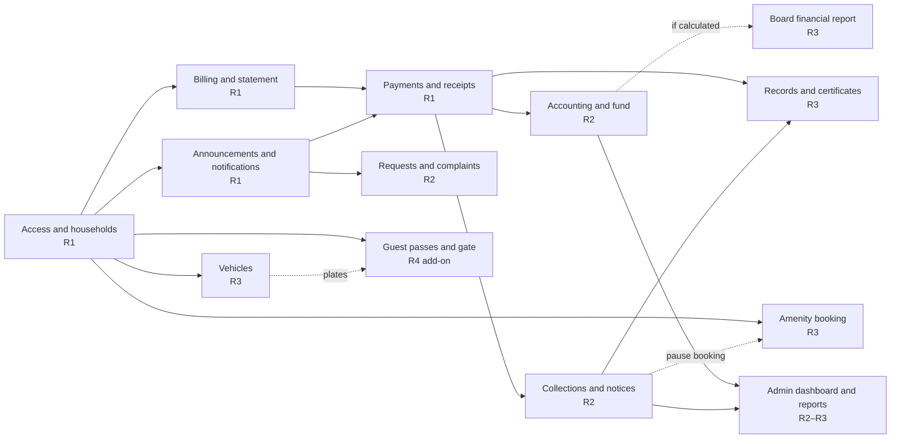

# HOA Portal Backlog

Business analysis of the HOA portal mock-up (`index.html`, and the branded copy `gentri-heights/index.html`, which has the same features). Every feature is broken into user stories with Gherkin acceptance criteria, then put in priority and dependency order.

| | |
|---|---|
| Status | **Draft for owner review** |
| Prepared | 2026-11-27 |
| Interactive version | [hoa-backlog.html](hoa-backlog.html) (open in a browser: filters, search, expandable criteria) |
| Published page | https://claude.ai/artifact/KwcymbfbiQbL4ZPj1JWhSh (private) |

**45 stories in 13 epics** · 17 Must · 20 Should · 8 Could · 8 stories for gaps not in the mock-up · 9 board decisions open.

## How to read this

- **Priority (MoSCoW).** *Must*: the portal fails its main job without it. *Should*: high value, can follow a release later. *Could*: worth building once the core is in use.
- **Releases.** R1 lets homeowners pay dues and get a receipt. Each later release builds only on what came before it.
- **Rank** is build order. A story never comes before a story it depends on. **Needs** lists those stories. **Unblocks** lists the stories waiting on it.
- **Size.** S is up to 1 day, M is 2–3 days and L is 4–6 days of build and test with Claude Code. Sol Arch should confirm these sizes.
- **Not in mock-up** marks a story for something the real app needs but the mock-up doesn't have.

## Related documents

- [Epics](../epics/README.md): one document per epic with the problem, success metrics, scope, risks, open questions and release slicing.
- [Glossary](../product/GLOSSARY.md): the one term to use for each concept, on screens and in requirements.
- [Personas](../product/PERSONAS.md): who uses the portal, on what device and how often. These are assumptions until checked with real residents and officers.

## Backlog summary

| # | Story | Epic | Priority | Size | Release | Needs | Waits on |
|---|---|---|---|---|---|---|---|
| 01 | [Sign in to the portal](#01-sign-in-to-the-portal) *(not in mock-up)* | Access and households | Must | M | R1 | — | D1 |
| 02 | [Roles and permissions enforced on the server](#02-roles-and-permissions-enforced-on-the-server) *(not in mock-up)* | Access and households | Must | M | R1 | 01 | D4 |
| 03 | [Household directory: add, edit and import](#03-household-directory-add-edit-and-import) *(not in mock-up)* | Access and households | Must | M | R1 | 02 | D3 |
| 04 | [Invite a homeowner and link them to a lot](#04-invite-a-homeowner-and-link-them-to-a-lot) *(not in mock-up)* | Access and households | Must | S | R1 | 01, 03 | D3 |
| 05 | [Privacy notice and consent](#05-privacy-notice-and-consent) *(not in mock-up)* | Access and households | Must | S | R1 | 01 | — |
| 06 | [Activity log of money and record changes](#06-activity-log-of-money-and-record-changes) *(not in mock-up)* | Access and households | Must | S | R1 | 02 | — |
| 07 | [Dues rate and QR payment settings](#07-dues-rate-and-qr-payment-settings) | Billing and statement | Must | S | R1 | 02 | — |
| 08 | [Monthly billing run](#08-monthly-billing-run) | Billing and statement | Must | M | R1 | 03, 07 | D2, D8 |
| 09 | [Statement of account](#09-statement-of-account) | Billing and statement | Must | M | R1 | 08 | D2 |
| 10 | [Submit a QR payment for approval](#10-submit-a-qr-payment-for-approval) | Payments and receipts | Must | M | R1 | 07, 09 | — |
| 11 | [In-app notifications](#11-in-app-notifications) | Announcements and notifications | Must | S | R1 | 02 | — |
| 12 | [Approve or reject a payment](#12-approve-or-reject-a-payment) | Payments and receipts | Must | L | R1 | 06, 10, 11 | D4 |
| 13 | [Official receipt PDF](#13-official-receipt-pdf) | Payments and receipts | Must | M | R1 | 12 | D5 |
| 14 | [Void an approved payment](#14-void-an-approved-payment) *(not in mock-up)* | Payments and receipts | Should | M | R1 | 12, 13 | — |
| 15 | [Homeowner dashboard](#15-homeowner-dashboard) | Billing and statement | Should | S | R1 | 09, 11 | — |
| 16 | [Post an announcement](#16-post-an-announcement) | Announcements and notifications | Should | S | R1 | 02 | — |
| 17 | [Important announcement shown on sign-in](#17-important-announcement-shown-on-sign-in) | Announcements and notifications | Should | S | R1 | 16 | — |
| 18 | [Delinquent accounts list](#18-delinquent-accounts-list) | Collections and notices | Must | S | R2 | 09, 12 | D2 |
| 19 | [Email for key events](#19-email-for-key-events) *(not in mock-up)* | Announcements and notifications | Should | M | R2 | 11 | — |
| 20 | [Send the next notice in the escalation](#20-send-the-next-notice-in-the-escalation) | Collections and notices | Must | M | R2 | 18 | — |
| 21 | [Send notices to several households at once](#21-send-notices-to-several-households-at-once) | Collections and notices | Should | S | R2 | 20 | — |
| 22 | [Record an expense](#22-record-an-expense) | Accounting and fund | Must | M | R2 | 02, 06 | — |
| 23 | [Collections by month](#23-collections-by-month) | Accounting and fund | Must | S | R2 | 12 | — |
| 24 | [Fund summary and closing a month](#24-fund-summary-and-closing-a-month) | Accounting and fund | Should | M | R2 | 22, 23 | — |
| 25 | [Admin operations dashboard](#25-admin-operations-dashboard) | Admin dashboard and reports | Should | S | R2 | 18, 23, 24 | — |
| 26 | [Log a request or complaint](#26-log-a-request-or-complaint) | Requests and complaints | Should | S | R2 | 01, 11 | — |
| 27 | [Assign, update and resolve a request](#27-assign-update-and-resolve-a-request) | Requests and complaints | Should | S | R2 | 26 | — |
| 28 | [Register a vehicle](#28-register-a-vehicle) | Vehicles | Should | S | R3 | 01 | — |
| 29 | [Approve a vehicle and assign a sticker](#29-approve-a-vehicle-and-assign-a-sticker) | Vehicles | Should | S | R3 | 28, 11 | — |
| 30 | [Set up amenities](#30-set-up-amenities) | Amenity booking | Should | S | R3 | 02 | — |
| 31 | [Book an amenity](#31-book-an-amenity) | Amenity booking | Should | L | R3 | 30 | D7 |
| 32 | [Approve or reject a booking](#32-approve-or-reject-a-booking) | Amenity booking | Should | M | R3 | 31, 11 | — |
| 33 | [Cancel a booking](#33-cancel-a-booking) | Amenity booking | Should | S | R3 | 31 | — |
| 34 | [Pause booking for accounts with overdue dues](#34-pause-booking-for-accounts-with-overdue-dues) | Amenity booking | Could | S | R3 | 31, 18 | — |
| 35 | [Standard reports with CSV download](#35-standard-reports-with-csv-download) | Admin dashboard and reports | Should | M | R3 | 18, 23, 24 | — |
| 36 | [Request a record or certificate](#36-request-a-record-or-certificate) | Records and certificates | Should | S | R3 | 01, 11 | — |
| 37 | [Fulfil or decline a record request](#37-fulfil-or-decline-a-record-request) | Records and certificates | Should | M | R3 | 36, 09, 35 | — |
| 38 | [Certificate of good standing](#38-certificate-of-good-standing) | Records and certificates | Should | S | R3 | 37, 18 | — |
| 39 | [Board financial report](#39-board-financial-report) | Board financial report | Could | M | R3 | 24 | D6 |
| 40 | [Create a guest pass](#40-create-a-guest-pass) | Guest passes and gate | Could | M | R4 | 01 | D9 |
| 41 | [Cancel a guest pass](#41-cancel-a-guest-pass) | Guest passes and gate | Could | S | R4 | 40 | — |
| 42 | [Guard verifies a pass at the gate](#42-guard-verifies-a-pass-at-the-gate) | Guest passes and gate | Could | L | R4 | 40, 02 | — |
| 43 | [Check guests in and out](#43-check-guests-in-and-out) | Guest passes and gate | Could | M | R4 | 42 | — |
| 44 | [Visitor log and gate scan log](#44-visitor-log-and-gate-scan-log) | Guest passes and gate | Could | S | R4 | 43 | — |
| 45 | [Delete ID photos automatically after the retention period](#45-delete-id-photos-automatically-after-the-retention-period) | Guest passes and gate | Could | S | R4 | 43, 05 | — |

## R1: Pay dues online

The smallest release that replaces the current process: households are on the portal, get billed, pay by QR, the treasurer approves, and an official receipt comes out. It also adds announcements so the HOA can tell residents the portal exists.

### 01 Sign in to the portal

**Must** · Size M · Access and households · Not in mock-up

As a homeowner, I want sign in with my email or Google account, so that only I can see my household’s account.

- **Needs:** nothing; can start first
- **Unblocks:** 02, 04, 05, 26, 28, 36, 40
- **Waits on:** D1 (Sign-in method: email link or Google, or SMS codes)

> **Note.** The mock-up has no sign-in: a role switch and a “Viewing as” picker let anyone see any household. Every other story depends on this one.

```gherkin
Feature: Signing in

  Scenario: An invited homeowner signs in for the first time
    Given Maria Santos was invited as "maria@example.com" for Blk 1 Lot 3
    When she signs in with that email
    Then she lands on her dashboard headed "Welcome back, Maria"
    And the header reads "Blk 1 Lot 3"

  Scenario: An email with no household cannot get in
    Given no household is linked to "stranger@example.com"
    When that person signs in
    Then they see "This email isn't linked to a household yet. Ask the admin office for an invitation."
    And no household data is shown

  Scenario: A homeowner cannot open another household's page
    Given Maria is signed in
    When she opens the address of the statement for Blk 4 Lot 12
    Then she sees "You don't have access to this page"

  Scenario: Signing out on a shared phone
    Given Maria is signed in
    When she chooses "Sign out"
    Then pressing Back shows the sign-in page, not her statement
```

### 02 Roles and permissions enforced on the server

**Must** · Size M · Access and households · Not in mock-up

As a treasurer, I want each person to see and do only what their role allows, so that homeowners, guards and board members cannot change records that aren’t theirs.

- **Needs:** 01
- **Unblocks:** 03, 06, 07, 11, 16, 22, 30, 42
- **Waits on:** D4 (Who approves payments: the treasurer only, or the treasurer plus the board)

> **Note.** Roles: Homeowner, Treasurer (admin), Admin office staff, Board member (read-only finance), Guard. A control hidden on screen is not the same as one the server refuses; Sol Arch confirms the rules.

```gherkin
Feature: Roles

  Scenario Outline: Each role sees only its own menu
    Given a user with the role <role>
    When they sign in
    Then the menu shows "<shown>"
    And the menu does not show "<hidden>"

    Examples:
      | role      | shown      | hidden     |
      | Homeowner | Dues & Payments | Approvals |
      | Guard     | Scan Pass  | Accounting |
      | Treasurer | Approvals  | Scan Pass  |
      | Board     | Reports    | Approvals  |

  Scenario: A refused action is refused by the server, not only hidden
    Given a guard is signed in
    When their device sends a request to approve a pending payment
    Then the request is refused
    And the payment still reads "Pending approval"

  Scenario: Removing someone's admin role takes effect at once
    Given an admin office staff member is signed in on the Approvals page
    When the treasurer removes their admin role
    Then their next action shows "You no longer have access to this page"
```

### 03 Household directory: add, edit and import

**Must** · Size M · Access and households · Not in mock-up

As a admin office staff member, I want to add, edit and import households with lot, owner name and contact details, so that billing reaches every lot in the subdivision.

- **Needs:** 02
- **Unblocks:** 04, 08
- **Waits on:** D3 (Owners with several lots, and tenant accounts)

> **Note.** The mock-up shows a fixed list of 20 sample homeowners with search and a detail pop-up, but no way to add or change one. backend-plan.md sizes the real portal at 623+ households.

```gherkin
Feature: Household directory

  Scenario: Import the household list
    Given a spreadsheet with 623 rows of lot, owner name, email and mobile number
    When the admin imports it
    Then the Homeowners page reads "623 households"

  Scenario: Bad rows are reported, not imported
    Given the spreadsheet has a row with no lot and two rows for "Blk 2 Lot 7"
    When the admin imports it
    Then a summary lists those 3 rows with the reason for each
    And none of them is imported
    And every other row is imported

  Scenario: Correct a contact number
    Given Blk 4 Lot 12 has mobile "0917 555 0101"
    When the admin changes it to "0917 555 0199" and saves
    Then the Homeowners list shows "0917 555 0199" for Blk 4 Lot 12

  Scenario: Search a long list
    Given 623 households
    When the admin types "blk 4" in "Search name or lot"
    Then only Block 4 households are listed
    And the rest of the page does not reload while typing
```

### 04 Invite a homeowner and link them to a lot

**Must** · Size S · Access and households · Not in mock-up

As a admin office staff member, I want to send each household an invitation, so that the right person is linked to the right lot.

- **Needs:** 01, 03
- **Unblocks:** —
- **Waits on:** D3 (Owners with several lots, and tenant accounts)

```gherkin
Feature: Linking an account to a lot

  Scenario: An invitation links the account to the lot
    Given Blk 2 Lot 7 has email "ana@example.com" and no linked account
    When the admin sends the invitation and Ana signs in from it
    Then the Homeowners list shows Blk 2 Lot 7 as "Linked"

  Scenario: An old invitation is replaced
    Given an invitation for Blk 2 Lot 7 was sent 15 days ago and never used
    When the admin presses "Resend invitation"
    Then the old link shows "This invitation has expired"
    And a new invitation goes to "ana@example.com"

  Scenario: A sold lot is unlinked without losing its history
    Given Blk 2 Lot 7 is sold
    When the admin unlinks Ana's account from Blk 2 Lot 7
    Then Ana no longer sees that lot's statement
    And the lot's bills and payments stay on the lot
```

### 05 Privacy notice and consent

**Must** · Size S · Access and households · Not in mock-up

As a homeowner, I want to know what personal data the HOA keeps and why, and agree to it, so that my data is handled under the Data Privacy Act.

- **Needs:** 01
- **Unblocks:** 45

> **Note.** backend-plan.md area I lists Data Privacy Act work. The gate add-on stores guests’ ID photos, which makes this more important.

```gherkin
Feature: Privacy notice

  Scenario: The first sign-in asks for consent
    Given Juan signs in for the first time
    Then he sees the privacy notice before his dashboard
    And "Continue" stays disabled until he ticks "I have read and agree"

  Scenario: Consent is recorded
    When Juan agrees on Dec 1, 2026
    Then his household record shows "Privacy notice accepted Dec 1, 2026"

  Scenario: An updated notice asks again
    Given the HOA publishes a new version of the notice
    When Juan next signs in
    Then he sees the new notice and must agree before continuing
```

### 06 Activity log of money and record changes

**Must** · Size S · Access and households · Not in mock-up

As a board member, I want every approval, rejection, void and edit recorded with who did it and when, so that disputes can be settled from the record.

- **Needs:** 02
- **Unblocks:** 12, 22

> **Note.** The mock-up’s “Recent activity” list has dates but no person or time, and anyone could clear it.

```gherkin
Feature: Activity log

  Scenario: An approval is recorded with person and time
    Given the treasurer approves Carlo Mendoza's ₱1,800.00 payment at 9:14 AM
    Then the activity log shows "HOA Treasurer approved ₱1,800.00 from Blk 5 Lot 1 (OR-00093)" with the date and 9:14 AM

  Scenario: No one can edit or delete the log
    Given an admin is signed in
    Then the activity log shows no edit or delete controls
    And a request to change a log entry is refused by the server
```

### 07 Dues rate and QR payment settings

**Must** · Size S · Billing and statement

As a treasurer, I want to set the monthly dues, upload the QR Ph code, and set the payee name and payment instructions, so that homeowners pay the right amount into the right account.

- **Needs:** 02
- **Unblocks:** 08, 10

```gherkin
Feature: Dues and payment settings

  Scenario: A new rate applies from the next billing run only
    Given dues are ₱1,800 and November 2026 is already billed
    When the treasurer changes the monthly dues to ₱2,000 and saves
    Then the November bills still read ₱1,800.00
    And the December 2026 billing run bills ₱2,000.00 per household

  Scenario: Uploading the real QR code
    When the treasurer uploads the association's QR Ph image
    Then homeowners see it on Dues & Payments labelled "SCAN TO PAY"
    And the "SAMPLE QR" label is gone

  Scenario: An invalid rate is not saved
    When the treasurer clears the monthly dues and presses "Save settings"
    Then the field shows "Enter the monthly dues in pesos, more than ₱0"
    And the saved rate is unchanged
```

### 08 Monthly billing run

**Must** · Size M · Billing and statement

As a treasurer, I want to bill one month’s dues to every household in one step, so that every statement is current on the 1st of the month.

- **Needs:** 03, 07
- **Unblocks:** 09
- **Waits on:** D2 (Late penalty, interest and grace period); D8 (Monthly billing: run by the treasurer, or automatic on the 1st)

> **Note.** The mock-up’s “Generate December 2026 billing” button can be pressed twice. The real version must refuse a second run for the same month.

```gherkin
Feature: Monthly billing

  Scenario: Bill the next month
    Given the last billed month is November 2026 and there are 623 households
    When the treasurer presses "Generate December 2026 billing" and confirms
    Then 623 bills of ₱1,800.00 for December 2026 are created, each due Dec 31, 2026
    And the button now reads "Generate January 2027 billing"

  Scenario: A month is never billed twice
    When the treasurer presses the button twice quickly, or on two devices at once
    Then exactly 623 bills exist for December 2026
    And the button reads "Saving…" and is disabled until the run finishes

  Scenario: A household added mid-month
    Given December 2026 is billed
    When the admin adds Blk 8 Lot 2 on Dec 10
    Then the admin is asked "Bill Blk 8 Lot 2 for December 2026?" before any bill is created
```

### 09 Statement of account

**Must** · Size M · Billing and statement

As a homeowner, I want to see each month billed, what I paid, and my balance, so that I know exactly what I owe and since when.

- **Needs:** 08
- **Unblocks:** 10, 15, 18, 37
- **Waits on:** D2 (Late penalty, interest and grace period)

> **Note.** The mock-up uses wide tables. Most homeowners will use a phone, so the statement and payment history need a card layout at 375 px.

```gherkin
Feature: Statement of account

  Scenario: Payments apply to the oldest month first
    Given Roberto was billed ₱1,800 for each month from June to November 2026
    And ₱5,400 of his payments are approved
    Then June, July and August read "Paid"
    And September and October read "Overdue" and November reads "Unpaid"
    And the balance reads ₱5,400.00

  Scenario: A payment waiting for approval does not lower the balance
    Given Grace has ₱3,600 waiting for approval
    Then her balance is unchanged
    And the statement shows "₱3,600.00 awaiting approval"

  Scenario: Download the statement
    When the homeowner presses "Download PDF"
    Then the PDF lists the same months, amounts and balance as the screen

  Scenario: Readable on a phone
    Given a screen 375 px wide
    Then each month shows as a card with period, due date, billed, paid and status
    And the page does not scroll sideways
```

### 10 Submit a QR payment for approval

**Must** · Size M · Payments and receipts

As a homeowner, I want to send the reference number and screenshot after I pay by QR, so that the treasurer can match it to the collection account.

- **Needs:** 07, 09
- **Unblocks:** 12

```gherkin
Feature: Submitting a payment

  Scenario: Submit a payment
    Given Carlo owes ₱1,800.00
    When he enters ₱1,800.00, reference "4012883219554", attaches the screenshot and presses "Submit for approval"
    Then his payment history shows ₱1,800.00 "Pending approval" with "Waiting for the treasurer"
    And the treasurer's Approvals badge goes up by 1

  Scenario: Pressing twice creates one payment
    When Carlo presses "Submit for approval" twice quickly
    Then one payment is created
    And the button reads "Saving…" and is disabled until the save finishes

  Scenario: A reference number that was already used
    Given reference "4012883219554" belongs to an approved payment
    When anyone submits it again
    Then they see "This reference number was already submitted on Nov 25, 2026. Check the number on your screenshot."
    And nothing is saved

  Scenario: A missing screenshot keeps what was typed
    When Carlo presses "Submit for approval" without a screenshot
    Then "Attach the screenshot of your payment confirmation" shows under that field
    And the amount and reference he typed are still there
```

### 11 In-app notifications

**Must** · Size S · Announcements and notifications

As a homeowner, I want a bell that tells me when something about my account changes, so that I don’t have to keep checking each page.

- **Needs:** 02
- **Unblocks:** 12, 15, 19, 26, 29, 32, 36

```gherkin
Feature: Notifications

  Scenario: Unread notifications are counted
    Given Juan has 2 unread notifications
    Then the bell shows "2"
    When he opens the bell and presses "Mark all read"
    Then the count is gone

  Scenario: Notifications are private
    Given Juan has a notification "Booking approved: Swimming Pool, Dec 5"
    When Maria opens her bell
    Then she does not see Juan's notification

  Scenario: Nothing yet
    Given a new homeowner with no notifications
    When they open the bell
    Then it reads "No notifications yet."
```

### 12 Approve or reject a payment

**Must** · Size L · Payments and receipts

As a treasurer, I want to check each submitted payment against the collection account, then approve or reject it, so that the books only count money that actually arrived.

- **Needs:** 06, 10, 11
- **Unblocks:** 13, 14, 18, 23
- **Waits on:** D4 (Who approves payments: the treasurer only, or the treasurer plus the board)

> **Note.** backend-plan.md: receipt numbers must have no gaps, which needs a Cloud Function, not browser code.

```gherkin
Feature: Payment approval

  Scenario: Approve a payment
    Given Carlo's ₱1,800.00 payment is pending and the last receipt issued is OR-00092
    When the treasurer opens the screenshot and presses "Approve"
    Then the payment reads "Approved" with receipt number OR-00093
    And Carlo's balance drops by ₱1,800.00
    And Carlo gets the notification "Payment approved: ₱1,800.00, OR-00093"

  Scenario: Rejecting needs a reason
    When the treasurer presses "Reject" on Carlo's payment
    Then "Reject" stays disabled until a reason is picked or typed
    When they pick "Amount does not match the screenshot" and confirm
    Then Carlo's history shows "Rejected: Amount does not match the screenshot"
    And his balance is unchanged

  Scenario: Two admins approve the same payment at once
    Given two admins have Carlo's pending payment open
    When both press "Approve"
    Then exactly one receipt number is issued
    And the second admin sees "This payment was already approved by HOA Treasurer"

  Scenario: Receipt numbers have no gaps
    Given 200 payments are approved by several admins over a month
    Then the receipt numbers run in order with none skipped or repeated

  Scenario: A typed rejection reason is not lost
    Given the treasurer has typed a rejection reason
    When they click outside the dialog
    Then the dialog stays open with the reason still typed
```

### 13 Official receipt PDF

**Must** · Size M · Payments and receipts

As a homeowner, I want an official receipt for every approved payment, so that I have proof of payment for my records.

- **Needs:** 12
- **Unblocks:** 14
- **Waits on:** D5 (Whether official receipts must follow the BIR format)

```gherkin
Feature: Official receipt

  Scenario: Download a receipt
    Given payment OR-00093 for ₱1,800.00 is approved
    When Carlo presses "Receipt PDF"
    Then the PDF shows OR-00093, "One Thousand Eight Hundred Pesos Only" and the reference number
    And it shows "Applied to: Association dues · October 2026  ₱1,800.00"

  Scenario: An overpayment becomes a credit
    Given Juan owes ₱1,800.00 and pays ₱2,000.00
    When his payment is approved
    Then his receipt shows "Advance payment (credit)  ₱200.00"
    And his statement balance reads "₱200.00 credit"

  Scenario: The same receipt every time
    Given OR-00093 was downloaded on Nov 27
    When the treasurer downloads it again on Dec 15
    Then the receipt number, amounts and date issued are the same
```

### 14 Void an approved payment

**Should** · Size M · Payments and receipts · Not in mock-up

As a treasurer, I want to void a payment I approved by mistake, with a reason, so that the books are corrected without losing or reusing the receipt number.

- **Needs:** 12, 13
- **Unblocks:** —

> **Note.** The mock-up has no way to undo an approval. backend-plan.md area C includes voids.

```gherkin
Feature: Voiding a payment

  Scenario: Void a payment approved by mistake
    Given OR-00093 for ₱1,800.00 was approved by mistake
    When the treasurer chooses "Void", enters "Duplicate of OR-00090" and confirms
    Then OR-00093 reads "Void" in Accounting and in Carlo's payment history
    And Carlo's balance goes back up by ₱1,800.00
    And the next receipt issued is OR-00094, not OR-00093

  Scenario: A voided receipt is marked
    When anyone downloads OR-00093 after it is voided
    Then the PDF is stamped "VOID" with the date and reason

  Scenario: Voiding needs a reason
    When the treasurer chooses "Void" and leaves the reason blank
    Then "Void payment" stays disabled
```

### 15 Homeowner dashboard

**Should** · Size S · Billing and statement

As a homeowner, I want a home page with my balance, anything overdue, and links to what I do most, so that I see what needs my attention as soon as I sign in.

- **Needs:** 09, 11
- **Unblocks:** —

> **Note.** Build the balance tile in R1. The booking, request and vehicle tiles appear as those features ship, so the dashboard never links to a feature that isn’t there yet.

```gherkin
Feature: Homeowner dashboard

  Scenario: An account with overdue dues
    Given Roberto has 2 months overdue totalling ₱3,600.00
    When he opens the dashboard
    Then he sees "2 months overdue · ₱3,600.00" with a "Pay now" button

  Scenario: A fully paid account
    Given Maria's balance is ₱0.00
    Then the balance tile reads "₱0.00" and "You are fully paid"
    And there is no overdue warning

  Scenario: Only tiles for released features
    Given amenity booking is not released yet
    Then the dashboard shows no "Next booking" tile
```

### 16 Post an announcement

**Should** · Size S · Announcements and notifications

As a admin office staff member, I want to post an announcement that every homeowner sees as a banner, so that news reaches everyone without a group chat.

- **Needs:** 02
- **Unblocks:** 17

```gherkin
Feature: Announcements

  Scenario: Post an announcement
    When the admin posts "Christmas party sign-ups are open"
    Then every homeowner sees it as a banner at the top of their pages
    And it is listed under Announcements

  Scenario: A homeowner dismisses the banner
    When Juan presses × on the banner
    Then the banner is gone for Juan only
    And the announcement is still listed under Announcements

  Scenario: Deleting asks first
    When the admin presses "Delete" on an announcement
    Then they see "Delete this announcement? Homeowners will no longer see it."
    And nothing is deleted until they confirm
```

### 17 Important announcement shown on sign-in

**Should** · Size S · Announcements and notifications

As a admin office staff member, I want to mark an announcement as important so it pops up when homeowners sign in, so that urgent notices like water interruptions are actually read.

- **Needs:** 16
- **Unblocks:** —

```gherkin
Feature: Important announcement pop-up

  Scenario: A must-read pop-up
    Given "Water interruption, Phase 2 on Dec 1" is marked Important
    When a homeowner who hasn't read it signs in
    Then a pop-up shows it before the dashboard
    And it closes only when they press "Got it"

  Scenario: Shown once per homeowner
    Given Juan pressed "Got it"
    When he signs in again
    Then the pop-up does not appear

  Scenario: The admin sees who has read it
    Given 120 of 623 households pressed "Got it"
    Then the admin sees "Seen by 120 of 623 households" on that announcement
```

## R2: Collect and account

Follow up on unpaid dues with the four-letter notice sequence, record expenses, keep the fund balance, and handle residents’ requests and complaints.

### 18 Delinquent accounts list

**Must** · Size S · Collections and notices

As a treasurer, I want a list of households with overdue months, the furthest behind first, so that I know who to follow up and how far behind they are.

- **Needs:** 09, 12
- **Unblocks:** 20, 25, 34, 35, 38
- **Waits on:** D2 (Late penalty, interest and grace period)

```gherkin
Feature: Delinquent accounts

  Scenario: An unpaid month becomes overdue after its due date
    Given November 2026 dues are due Nov 30, 2026
    And Blk 3 Lot 2 has not paid November
    When it is Dec 1, 2026
    Then Blk 3 Lot 2 is listed under Delinquent accounts
    And the Homeowners list shows it as "Delinquent"

  Scenario: Paying the overdue amount removes the household
    Given Blk 3 Lot 2 is delinquent by ₱1,800.00
    When a ₱1,800.00 payment from Blk 3 Lot 2 is approved
    Then Blk 3 Lot 2 is no longer listed
    And the Homeowners list shows it as "Good standing"

  Scenario: Furthest behind first
    Given Blk 3 Lot 2 is 3 months overdue and Blk 1 Lot 3 is 1 month overdue
    Then Blk 3 Lot 2 is listed above Blk 1 Lot 3
```

### 19 Email for key events

**Should** · Size M · Announcements and notifications · Not in mock-up

As a homeowner, I want an email when a payment is approved or rejected, a notice is issued, or a record I asked for is ready, so that I hear about it even if I don’t open the portal.

- **Needs:** 11
- **Unblocks:** —

> **Note.** The app can only confirm an email was handed to the mail service, not that it arrived. Screens must say “sent” or “queued”, never “delivered”.

```gherkin
Feature: Email notifications

  Scenario: Payment approved
    When the treasurer approves Carlo's payment
    Then an email to Carlo is sent with the subject "Payment received: OR-00093"
    And the activity log shows "Email sent to Blk 5 Lot 1"

  Scenario: A bounced email is flagged
    Given the mail service reports that Carlo's address bounced
    Then the Homeowners list shows "Email bounced" on Blk 5 Lot 1

  Scenario: Announcements can be turned off but notices cannot
    When Carlo turns off "Announcement emails"
    Then he gets no announcement emails
    And he still gets emails for payment decisions and notices
```

### 20 Send the next notice in the escalation

**Must** · Size M · Collections and notices

As a treasurer, I want to send the next letter in the sequence (Reminder, 1st Notice, 2nd Notice, Final Demand), so that follow-up is consistent and on record.

- **Needs:** 18
- **Unblocks:** 21

> **Note.** In the mock-up a notice is only recorded. Sending it by email depends on story 19.

```gherkin
Feature: Collection notices

  Scenario: The next step is chosen for the treasurer
    Given Blk 3 Lot 2 last received a 2nd Notice
    Then its button reads "Send Final Demand"

  Scenario: Preview before sending
    When the treasurer presses "Send Final Demand" for Blk 3 Lot 2
    Then a letter preview shows the balance, each unpaid month, and a deadline 10 days from today
    When they confirm
    Then the notice appears in Notice history
    And the homeowner sees it under "Notices received" with "View letter"

  Scenario: Final Demand is the last step
    Given Blk 3 Lot 2 already received a Final Demand
    Then its button reads "Resend Final Demand"

  Scenario: Pressing twice sends one notice
    When the treasurer confirms twice quickly
    Then one notice is recorded
```

### 21 Send notices to several households at once

**Should** · Size S · Collections and notices

As a treasurer, I want to send each selected household its next notice in one action, so that the monthly follow-up takes minutes instead of an afternoon.

- **Needs:** 20
- **Unblocks:** —

```gherkin
Feature: Bulk notices

  Scenario: Send to the selected households
    Given 12 delinquent households are ticked
    When the treasurer presses "Send next notice to selected"
    Then they see "Send 12 notices?" with a count of each notice type
    When they confirm
    Then each household gets its own next notice

  Scenario: Nothing selected
    When the treasurer presses "Send next notice to selected" with nothing ticked
    Then they see "Select at least one account first."
```

### 22 Record an expense

**Must** · Size M · Accounting and fund

As a treasurer, I want to record each expense with its date, category, vendor, amount and a photo of the receipt, so that the fund balance shows what was actually spent.

- **Needs:** 02, 06
- **Unblocks:** 24

> **Note.** The mock-up deletes an expense for good. Money records should be voided with a reason so the books keep a trail.

```gherkin
Feature: Expenses

  Scenario: Record an expense
    When the treasurer saves ₱7,500.00 to "AquaFix Pool Services" for "Pool pump repair" on Sep 18, 2026 under "Repairs & maintenance"
    Then it appears under Expenses for September 2026
    And the September fund summary's expenses go up by ₱7,500.00

  Scenario: Void instead of delete
    When the treasurer voids that expense with the reason "Entered twice"
    Then it shows crossed out as "Void" with the reason
    And it is left out of every total
    And the activity log records who voided it

  Scenario: A required field is missing
    When the treasurer saves without a vendor
    Then "Enter who was paid" shows under Vendor and the other fields keep what was typed
```

### 23 Collections by month

**Must** · Size S · Accounting and fund

As a treasurer, I want to see every dues receipt and amenity fee collected in a month, with totals, so that I can reconcile the month against the bank account.

- **Needs:** 12
- **Unblocks:** 24, 25, 35

```gherkin
Feature: Monthly collections

  Scenario: The month's totals match its receipts
    Given 17 dues payments totalling ₱30,600.00 were approved in November 2026
    When the treasurer opens Accounting, Collections for November 2026
    Then 17 receipts are listed and the total reads ₱30,600.00

  Scenario: Deposits are not income
    Given a Function Room booking with a ₱2,500 fee and a ₱1,000 deposit was approved in November
    Then November's amenity fees include ₱2,500.00
    And the ₱1,000.00 deposit is not counted as income

  Scenario: Voided payments are excluded
    Given OR-00093 was voided
    Then it shows as "Void" and is left out of the total
```

### 24 Fund summary and closing a month

**Should** · Size M · Accounting and fund

As a treasurer, I want the fund balance for each month and the ability to close a finished month, so that the numbers I report to the board stop changing after I report them.

- **Needs:** 22, 23
- **Unblocks:** 25, 35, 39

```gherkin
Feature: Fund summary

  Scenario: Closing balance
    Given October 2026 opens at ₱185,000.00 with ₱30,600.00 dues, ₱850.00 amenity fees and ₱28,600.00 expenses
    Then the October fund summary shows a closing balance of ₱187,850.00
    And November opens at ₱187,850.00

  Scenario: A closed month can't be changed
    Given the treasurer closed October 2026
    When anyone records an expense dated Oct 20, 2026
    Then they see "October 2026 is closed. Date this in an open month, or ask the board to reopen October."
    And nothing is saved
```

### 25 Admin operations dashboard

**Should** · Size S · Admin dashboard and reports

As a treasurer, I want one page with this month’s collections, receivables, expenses and pending approvals, so that I can see where things stand without opening every page.

- **Needs:** 18, 23, 24
- **Unblocks:** —

```gherkin
Feature: Admin dashboard

  Scenario: Tiles match the pages they summarise
    When the treasurer opens the Dashboard
    Then "Collected · November 2026" equals the total in Accounting, Collections for November 2026
    And "Receivables" equals the sum of every household's balance due

  Scenario: Pending approvals
    Given 3 payments, 3 bookings and 2 vehicles are waiting
    Then the "Pending approvals" tile reads 8 with "3 payments · 3 bookings · 2 vehicles"

  Scenario: A new portal
    Given nothing has been collected yet
    Then the chart shows "No collections recorded yet" instead of empty bars
```

### 26 Log a request or complaint

**Should** · Size S · Requests and complaints

As a homeowner, I want to report a maintenance, security or neighbour problem with a photo, so that the admin office has it in writing and I can follow its progress.

- **Needs:** 01, 11
- **Unblocks:** 27

```gherkin
Feature: Logging a request

  Scenario: Submit a request
    When Bea submits "Clogged drainage on Acacia St." under Maintenance with a photo
    Then it appears under My requests as T-105 "Open"
    And its timeline reads "Request submitted."
    And the admin's Requests & Complaints badge goes up by 1

  Scenario: Details are required
    When Bea submits without details
    Then "Describe what happened, where, and since when" shows under Details
    And the subject she typed is kept

  Scenario: A large photo
    When Bea attaches a 9 MB photo
    Then it is resized before upload and the request is saved
```

### 27 Assign, update and resolve a request

**Should** · Size S · Requests and complaints

As a admin office staff member, I want to assign a request, post progress updates and resolve it, so that homeowners can see their problem is being handled.

- **Needs:** 26
- **Unblocks:** —

```gherkin
Feature: Managing requests

  Scenario: Assign and update
    Given T-103 "Videoke past 10 PM on Blk 5" is Open
    When the admin assigns it to "Security", sets "In Progress" and adds "Guard will check on Saturday night"
    Then the homeowner's timeline shows that update with the date
    And the homeowner gets a notification "T-103 update: Guard will check on Saturday night"

  Scenario: Resolving needs a note
    When the admin sets T-103 to "Resolved" with no note
    Then "Say how it was resolved" shows and the status does not change

  Scenario: Filter by status
    When the admin picks "Open"
    Then only Open requests are listed and the chip shows how many
```

## R3: Community services and records

Vehicle stickers, amenity booking, the admin reports, and certificates and records that homeowners request.

### 28 Register a vehicle

**Should** · Size S · Vehicles

As a homeowner, I want to register my vehicle with its plate and an optional OR/CR photo, so that I get an HOA sticker for gate entry.

- **Needs:** 01
- **Unblocks:** 29

```gherkin
Feature: Vehicle registration

  Scenario: Register a vehicle
    When Juan registers "ABC 1234", a white Toyota Vios car
    Then it is listed under Registered vehicles as "Pending approval"

  Scenario: A plate registered to another household
    Given "ABC 1234" is approved for Blk 4 Lot 12
    When a homeowner at another lot registers "ABC 1234"
    Then they see "This plate is already registered to another household. Contact the admin office."

  Scenario: Withdraw a pending registration
    When Juan presses "Withdraw" on a pending vehicle and confirms
    Then it is no longer listed
```

### 29 Approve a vehicle and assign a sticker

**Should** · Size S · Vehicles

As a admin office staff member, I want to approve a vehicle and give it the next sticker number, so that every sticker matches exactly one approved vehicle.

- **Needs:** 28, 11
- **Unblocks:** —

```gherkin
Feature: Vehicle approval

  Scenario: Approve
    Given the next sticker number is #0460
    When the admin approves "NFT 3390"
    Then it reads "Approved · Sticker #0460" for the homeowner
    And the next vehicle approved gets #0461

  Scenario: Two approvals at once never share a sticker
    When two admins approve two different vehicles at the same moment
    Then the vehicles get different sticker numbers

  Scenario: Reject with a reason
    When the admin rejects "312 QWE" with "Plate does not match the OR/CR"
    Then the homeowner sees that reason under the vehicle
```

### 30 Set up amenities

**Should** · Size S · Amenity booking

As a treasurer, I want to set each amenity’s fee, deposit, guest limit, time slots and whether it can be booked, so that bookings follow the board’s rules.

- **Needs:** 02
- **Unblocks:** 31

```gherkin
Feature: Amenity setup

  Scenario: A price change applies to new bookings only
    Given a pending Function Room booking at ₱2,500
    When the treasurer changes the Function Room fee to ₱3,000
    Then the pending booking still reads ₱2,500.00
    And new Function Room bookings show ₱3,000.00

  Scenario: Close an amenity for repairs
    When the treasurer unticks "Bookable" for the Swimming Pool
    Then homeowners no longer see the Swimming Pool when booking
    And existing approved pool bookings are listed for the admin to contact
```

### 31 Book an amenity

**Should** · Size L · Amenity booking

As a homeowner, I want to pick an amenity, a date and an open slot and request it, so that I can reserve the pool, function room or courts without going to the office.

- **Needs:** 30
- **Unblocks:** 32, 33, 34
- **Waits on:** D7 (Amenity fee: paid with the request, or after approval)

> **Note.** In the mock-up the homeowner pays the fee before the booking is approved, and nothing says what happens to that money if the booking is rejected. Decision D7.

```gherkin
Feature: Booking an amenity

  Scenario: Request an open slot
    Given the Pickleball Court has 07:00–08:00 open on Nov 29, 2026
    When Juan picks it for 4 guests and presses "Request booking"
    Then My bookings shows it as "Pending approval"
    And other homeowners see that slot as "On hold"

  Scenario: Two homeowners request the same slot
    Given Juan and Ana both have 07:00–08:00 on Nov 29 open on screen
    When both press "Request booking"
    Then one request is saved
    And the other sees "Someone just requested this slot. Pick another one."

  Scenario: Past dates and full days
    Then dates before today cannot be picked
    And a day with every slot taken is marked "Fully booked"

  Scenario: Too many guests
    When Juan enters 12 guests for the Pickleball Court, which allows 8
    Then he sees "The Pickleball Court allows up to 8 guests"
```

### 32 Approve or reject a booking

**Should** · Size M · Amenity booking

As a admin office staff member, I want to approve or reject booking requests, warned about slot conflicts and overdue accounts, so that no slot is double-booked.

- **Needs:** 31, 11
- **Unblocks:** —

```gherkin
Feature: Booking approval

  Scenario: Approve
    When the admin approves Carmela's Function Room booking for Dec 19, 13:00–17:00
    Then she gets the notification "Booking approved: Function Room, Dec 19, 13:00–17:00"
    And the ₱2,500.00 fee counts as amenity income in the month it was approved

  Scenario: A slot already taken
    Given another approved booking holds the same amenity, date and slot
    Then that request shows "Slot conflict"
    And its "Approve" button is disabled

  Scenario: Reject with a reason
    When the admin rejects with "Slot is reserved for an HOA event"
    Then the homeowner sees that reason under the booking
    And the slot is open again
```

### 33 Cancel a booking

**Should** · Size S · Amenity booking

As a homeowner, I want to cancel a booking I no longer need, so that the slot is free for someone else.

- **Needs:** 31
- **Unblocks:** —

```gherkin
Feature: Cancelling a booking

  Scenario: Cancel an upcoming booking
    When Juan presses "Cancel" on his Dec 5 pool booking
    Then he sees "Cancel this booking? The slot opens up for other homeowners. Refunds of paid fees are handled at the admin office."
    When he confirms
    Then the booking reads "Cancelled" and the slot shows "Available"
    And the admin gets a notification

  Scenario: Past bookings can't be cancelled
    Given a booking dated yesterday
    Then it has no "Cancel" button
```

### 34 Pause booking for accounts with overdue dues

**Could** · Size S · Amenity booking

As a treasurer, I want a setting that stops households with overdue dues from booking amenities, so that the board’s rule is applied the same way to everyone.

- **Needs:** 31, 18
- **Unblocks:** —

```gherkin
Feature: Booking pause for overdue accounts

  Scenario: The setting is on
    Given "Block amenity booking for accounts with overdue dues" is ticked
    And Grace's account is overdue
    When she opens Book Amenities
    Then she sees "Booking is paused for your account" with "Go to Dues"
    And "Request booking" is disabled

  Scenario: Booking resumes after payment
    When Grace's overdue payment is approved
    Then she can request a booking again
```

### 35 Standard reports with CSV download

**Should** · Size M · Admin dashboard and reports

As a treasurer, I want ready-made reports I can download as CSV for Excel or Google Sheets, so that I can prepare the board’s monthly papers without retyping figures.

- **Needs:** 18, 23, 24
- **Unblocks:** 37

> **Note.** Reports: Collection, Delinquency and aging, Income and expense statement, Amenity utilisation, Requests summary, Vehicle registry. Each of the last three needs its own feature to be released first.

```gherkin
Feature: Reports

  Scenario: The CSV matches the screen
    Given the Collection report for November 2026 shows 17 receipts totalling ₱30,600.00
    When the treasurer presses "Download CSV"
    Then the file opens in Excel with 17 rows and a total of 30600.00

  Scenario: Aging buckets
    Given Blk 3 Lot 2 is 3 months overdue by ₱5,400.00
    Then the Delinquency and aging report puts ₱5,400.00 under "2–3 months"

  Scenario: A month with no data
    When the treasurer picks a month with no collections
    Then the report reads "No data for this period."
```

### 36 Request a record or certificate

**Should** · Size S · Records and certificates

As a homeowner, I want to ask the association for a financial report, certified statement, clearance or other record, so that I can get what I need for a sale, a loan or a general assembly.

- **Needs:** 01, 11
- **Unblocks:** 37

> **Note.** Members may request the association’s records under R.A. 9904; the mock-up quotes this. Sol Arch or counsel should confirm what the HOA must release.

```gherkin
Feature: Record requests

  Scenario: Request a clearance
    When Maria requests a "Certificate of good standing" for "Sale or transfer of property", to pick up at the office
    Then My report requests shows it as "Submitted" with "Expected by Dec 2, 2026"

  Scenario: Warning for an overdue account
    Given Grace's account is overdue
    When she selects "Certificate of good standing"
    Then she sees "Your account has overdue dues, so this request will likely be declined until you settle the balance."

  Scenario: Notified when ready
    When her request is marked Ready
    Then she gets a notification and the request shows "Download"
```

### 37 Fulfil or decline a record request

**Should** · Size M · Records and certificates

As a admin office staff member, I want to generate the record from portal data, upload a file, or decline with a reason, so that every request is answered on time.

- **Needs:** 36, 09, 35
- **Unblocks:** 38

```gherkin
Feature: Processing record requests

  Scenario: Generate from portal records
    Given RR-102 asks for a Certified statement of account
    When the admin presses "Generate from portal records"
    Then RR-102 reads "Ready" and the homeowner can download the statement

  Scenario: Upload a document the portal can't make
    Given RR-103 asks for minutes of board meetings
    When the admin uploads "Minutes-2026.pdf" (2 MB) and presses "Upload and mark ready"
    Then RR-103 reads "Ready" with that file

  Scenario: A file that is too large
    When the admin uploads a 5 MB file
    Then they see "Upload a PDF or image up to 3 MB" and the status does not change

  Scenario: Late requests stand out
    Given a request is still open after its expected date
    Then the admin list shows "Past due" in red on that request
```

### 38 Certificate of good standing

**Should** · Size S · Records and certificates

As a homeowner selling my lot, I want a numbered certificate stating I have no overdue dues, so that the buyer and the bank accept it.

- **Needs:** 37, 18
- **Unblocks:** —

```gherkin
Feature: Certificate of good standing

  Scenario: Issue a certificate
    Given Maria has no overdue dues
    When the admin generates her certificate on Nov 27, 2026
    Then the PDF is numbered GS-102 and states she has no overdue dues as of Nov 27, 2026
    And it reads "valid for thirty (30) days from the date of issue"

  Scenario: Refused while dues are overdue
    Given Grace has ₱3,600.00 overdue
    Then "Generate from portal records" is disabled
    And the admin sees "A clearance can't be issued while the account has ₱3,600.00 overdue."
```

### 39 Board financial report

**Could** · Size M · Board financial report

As a board member, I want a visual report of revenue, collections by month and by phase, and spending, so that I can present the association’s finances at the general assembly.

- **Needs:** 24
- **Unblocks:** —
- **Waits on:** D6 (Board financial report: typed in, or calculated from portal records)

> **Note.** The mock-up’s figures are typed in, and its August dues-by-phase total doesn’t match August’s monthly collections. The board must decide whether this report is typed in or calculated from portal records (D6). If it is calculated, it depends on story 24.

```gherkin
Feature: Board financial report

  Scenario: Figures that don't agree are flagged
    Given dues by phase add up to ₱97,456 for August but monthly collections show ₱114,640
    Then the report shows "Aug figures don't match" with the ₱17,184 difference
    And the August total is highlighted

  Scenario: Download for the assembly
    When a board member presses "Download PDF"
    Then the PDF has the summary, monthly collections, dues by phase, and cost and expenses tables

  Scenario: Chart has a table for screen readers
    When a board member opens "View as table"
    Then every month's dues, others and total are listed
```

## R4: Gate add-on

Guest passes and the guard’s phone app. backend-plan.md prices this separately at +6–10 days, so it ships last and only if the board wants it.

### 40 Create a guest pass

**Could** · Size M · Guest passes and gate

As a homeowner, I want to create a QR pass listing my guests and their vehicles, so that my visitors get through the gate without the guard calling me.

- **Needs:** 01
- **Unblocks:** 41, 42
- **Waits on:** D9 (Whether the gate add-on is in scope (+6–10 days))

```gherkin
Feature: Guest passes

  Scenario: Create a pass
    When Juan creates a pass for Nov 27, 2026 with guests "Rosa Dela Cruz" and "Miguel Dela Cruz" and vehicle "NDA 4471"
    Then he sees a QR code and an 8-character pass code
    And he can download the pass image to send by Messenger, Viber or SMS

  Scenario: Longer than allowed
    Given the longest allowed pass is 3 days
    When Juan sets Nov 27 to Dec 2
    Then he sees "A guest pass can cover up to 3 days" and nothing is created

  Scenario: At least one guest
    When Juan creates a pass with no guest names
    Then he sees "Add at least one guest's full name, as on their ID"
```

### 41 Cancel a guest pass

**Could** · Size S · Guest passes and gate

As a homeowner, I want to cancel a pass I no longer want used, so that nobody gets in with it.

- **Needs:** 40
- **Unblocks:** —

```gherkin
Feature: Cancelling a guest pass

  Scenario: Cancel a pass
    When Juan cancels GP-1043 and confirms
    Then GP-1043 reads "Cancelled" in his past passes

  Scenario: Someone uses a cancelled pass
    Given GP-1043 is cancelled
    When the guard scans it
    Then the guard sees "Pass cancelled. Do not let the guests in without calling them."
    And Juan gets "Someone tried to use your cancelled guest pass GP-1043 at the gate at 4:12 PM."
```

### 42 Guard verifies a pass at the gate

**Could** · Size L · Guest passes and gate

As a guard, I want to scan a guest’s QR with the phone camera, or type the pass code, so that I know in seconds whether to let them in.

- **Needs:** 40, 02
- **Unblocks:** 43

> **Note.** The mock-up reads a photo of the QR. backend-plan.md says the real app needs a live camera view.

```gherkin
Feature: Verifying a guest pass

  Scenario Outline: The verdict the guard sees
    Given a pass that is <state>
    When the guard scans it
    Then the guard sees "<verdict>"
    And the scan is recorded with the result "<result>"

    Examples:
      | state                 | verdict           | result   |
      | valid today           | Valid pass        | Valid    |
      | starting tomorrow     | Not valid yet     | Upcoming |
      | ended yesterday       | Pass expired      | Expired  |
      | cancelled             | Pass cancelled    | Cancelled|

  Scenario: A fake or altered QR
    When the guard scans a QR that is not one of this subdivision's passes
    Then the guard sees "This QR is not a valid guest pass for this subdivision. It may be fake or altered."
    And the scan is recorded as "Invalid"

  Scenario: The guest's phone is dead
    Given GP-1041 is expected today
    When the guard taps it in "Expected today"
    Then the pass opens without scanning
```

### 43 Check guests in and out

**Could** · Size M · Guest passes and gate

As a guard, I want to photograph each guest’s ID, let them in, and check them out when they leave, so that the HOA knows who is inside the subdivision.

- **Needs:** 42
- **Unblocks:** 44, 45

```gherkin
Feature: Check-in and check-out

  Scenario: Let a guest in
    Given GP-1041 is valid and ID photos are required
    When the guard picks "PhilSys National ID", takes the photo, picks "NDA 4471" and presses "Let in"
    Then Rosa Dela Cruz shows "Inside since 9:12 AM"
    And she is listed under Visitors Inside

  Scenario: No ID photo
    When the guard presses "Let in" without a photo
    Then they see "Take a photo of the guest's ID" and the guest stays "Not yet arrived"

  Scenario: Check out
    When the guard presses "Check out" for Rosa
    Then she shows "Left 1:20 PM" and leaves Visitors Inside
```

### 44 Visitor log and gate scan log

**Could** · Size S · Guest passes and gate

As a admin office staff member, I want a searchable log of every arrival and every scan, including refused ones, so that I can answer “who came in?” after an incident.

- **Needs:** 43
- **Unblocks:** —

```gherkin
Feature: Visitor log

  Scenario: Search the log
    When the admin searches "NDA 4471"
    Then only visits with that plate are listed

  Scenario: Opening an ID photo is recorded
    When the admin opens Rosa Dela Cruz's ID photo
    Then the activity log records who opened it and when

  Scenario: Homeowners don't see ID photos
    When Juan views his past guest passes
    Then he sees arrival counts and times only, with no ID photos
```

### 45 Delete ID photos automatically after the retention period

**Could** · Size S · Guest passes and gate

As a board member, I want guests’ ID photos deleted on schedule, so that the HOA keeps personal data no longer than its privacy policy says.

- **Needs:** 43, 05
- **Unblocks:** —

> **Note.** Must-have if the gate add-on is built. The mock-up deletes old photos only when an admin presses a button. The real app should do it on a schedule.

```gherkin
Feature: ID photo retention

  Scenario: Old photos are deleted on schedule
    Given ID photos are kept for 30 days
    And Pedro Santos's visit was on Oct 12, 2026
    When the daily cleanup runs on Nov 12, 2026
    Then Pedro's ID photo is deleted
    And his visit record stays, with the ID column reading "Deleted"

  Scenario: Shortening the retention period
    When the admin changes the period from 30 days to 14 days
    Then photos older than 14 days are deleted at the next cleanup
```

## Epic dependency map



## What the review found

Ranked by how often people will run into it.

| # | Finding in the mock-up | Who it hurts | Covered by |
|---|---|---|---|
| 1 | There is no sign-in. Anyone can switch to Admin and see every household’s balance and contact number. | Every homeowner (privacy) | 1, 2, 4 |
| 2 | Homeowner pages use wide tables (statement, payment history, my bookings) that scroll sideways on a phone. | Homeowners, who mostly use phones | 9, 15 |
| 3 | Submitting a payment has no "Saving…" guard and no check for a reference number that was already used. | Treasurer, who would approve duplicates | 10 |
| 4 | An approved payment can’t be voided, and deleting an expense leaves no trail. | Treasurer and board, when the books need correcting | 14, 22, 6 |
| 5 | Clicking outside a dialog closes it and loses what was typed (rejection reason, request update, file upload). | Treasurer and admin office | 12, 27, 37 |
| 6 | Households can’t be added or edited; the list is fixed sample data. | Admin office, at onboarding and every sale | 3, 4 |
| 7 | The amenity fee is paid before the booking is approved, and there is no refund path if it is rejected. | Homeowners, treasurer | 31 (D7) |
| 8 | Monthly billing is a button that can run twice for the same month. | Every household (double billing) | 8 |
| 9 | The board financial report uses typed-in figures, and August dues by phase are ₱17,184 short of August’s monthly collections. | Board, at the general assembly | 39 (D6) |
| 10 | The guard scans a photo of the QR, not a live camera view, and old ID photos are deleted only by pressing a button. | Guards; guests (privacy) | 42, 45 |

## Decisions the HOA board needs to make

D1–D5 come from `docs/backend-plan.md`. D6–D9 came up in this review.

| # | Decision | Why it matters | Blocks |
|---|---|---|---|
| D1 | Sign-in method: email link or Google, or SMS codes | SMS is charged per message (backend-plan.md); email or Google costs nothing | 1 |
| D2 | Late penalty, interest and grace period | Changes what a statement shows as due and when an account becomes overdue | 8, 9, 18 |
| D3 | Owners with several lots, and tenant accounts | Decides whether one sign-in can see several lots, and whether tenants get their own login | 3, 4 |
| D4 | Who approves payments: the treasurer only, or the treasurer plus the board | Sets the roles and whether approval has one or two steps | 2, 12 |
| D5 | Whether official receipts must follow the BIR format | Changes the receipt layout and numbering rules | 13 |
| D6 | Board financial report: typed in, or calculated from portal records | If calculated, it waits for the fund summary (story 24) | 39 |
| D7 | Amenity fee: paid with the request, or after approval | Paying after approval removes the refund problem when a booking is rejected | 31 |
| D8 | Monthly billing: run by the treasurer, or automatic on the 1st | Automatic billing needs a scheduled job; manual billing needs a reminder | 8 |
| D9 | Whether the gate add-on is in scope (+6–10 days) | Decides whether release R4 is built | 40–45 |

## Next step

Once the owner approves the order, Sol Arch reviews feasibility and sizes, then the R1 stories become REQ documents with UX notes and mockups. Names and figures in the criteria are the mock-up's sample data, not real residents.
